<div align="center">

🇷🇺 **Русский** · [🇬🇧 English](README_EN.md) · [🇪🇬 العربية](README_AR.md) · [🇮🇷 فارسی](README_FA.md) · [🇨🇳 简体中文](README_ZH_CN.md) · [🇪🇸 Español](README_ES.md) · [🇹🇷 Türkçe](README_TR.md)

<h1 align="center">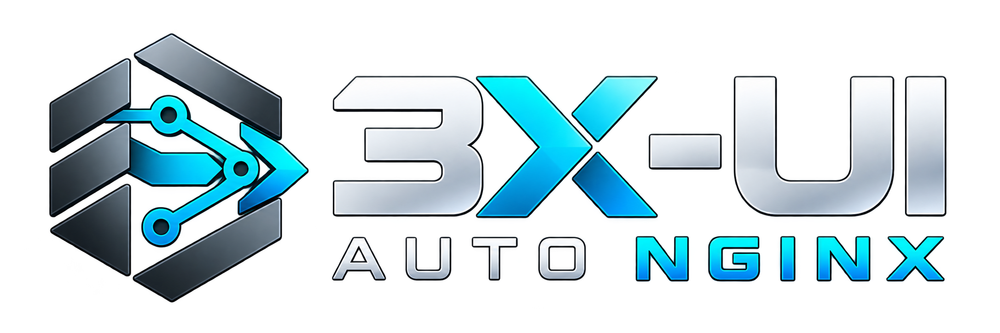</h1>

<a id="automated-deployment-of-3x-ui--xray-core-on-your-own-vps"></a>
<a id="автоматическое-развёртывание-3x-ui--xray-core-на-собственном-vps"></a>

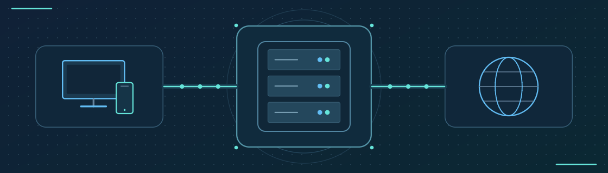

[](#installation)
[](#installation-vs-update)
[](https://xpromsx.github.io/3x-ui-auto-nginx/)
[](#support-development)

[](https://github.com/xPROMSx/3x-ui-auto-nginx/releases)
[](https://github.com/xPROMSx/3x-ui-auto-nginx/releases)
[](#technical-details)
[](#technical-details)

[📣 Telegram-канал](https://t.me/promsdev) · [📚 Все инструкции и гайды по проекту и 3X-UI](https://xpromsx.github.io/3x-ui-auto-nginx/guides/)

</div>

**3X-UI AUTO NGINX** - бесплатный установщик [3x-ui](https://github.com/MHSanaei/3x-ui) и Xray для вашего VPS. Два домена, чистый сервер и одна команда: установщик настроит nginx, сертификаты, несколько способов подключения и личную ссылку подписки. Дальнейшие операции доступны через единый менеджер, без ручного редактирования штатных конфигураций.

<a id="-why-this-project"></a>
<a id="why-this-project"></a>

## ✨ Почему этот проект?

<div align="center">

<a href="https://xpromsx.github.io/3x-ui-auto-nginx/start/">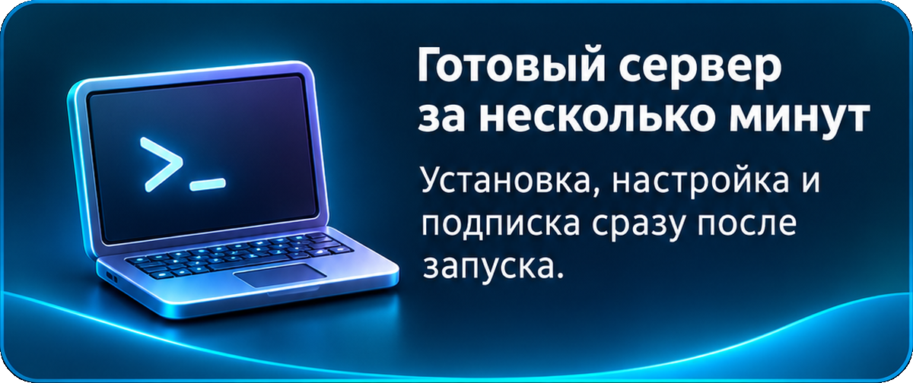</a>
<a href="#cover-sites">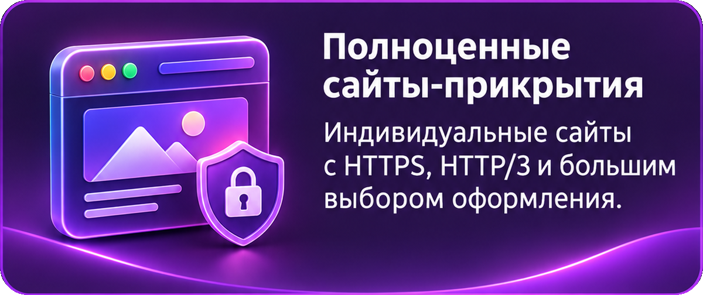</a>

<a href="https://xpromsx.github.io/3x-ui-auto-nginx/guides/cascade/">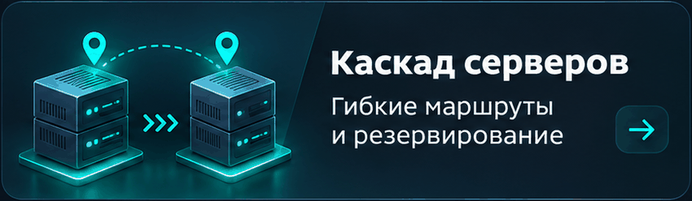</a>
<a href="https://xpromsx.github.io/3x-ui-auto-nginx/guides/security/">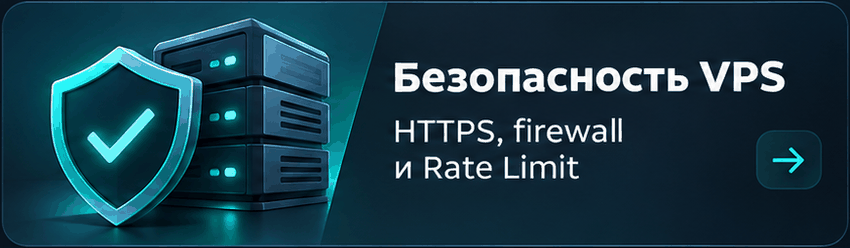</a>

<a href="https://xpromsx.github.io/3x-ui-auto-nginx/guides/backup/">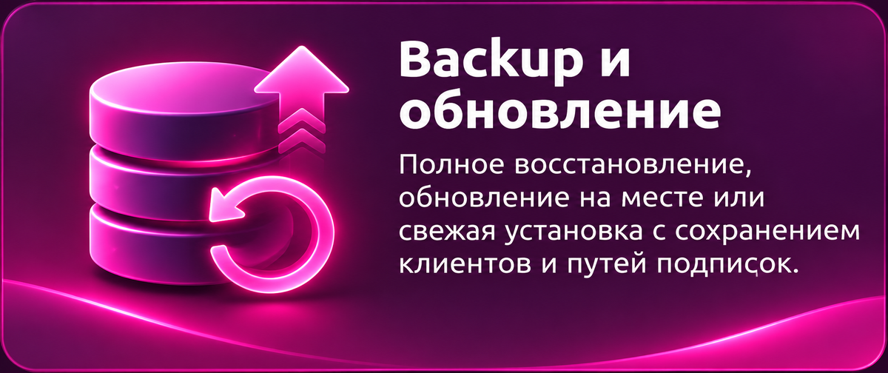</a>
<a href="https://xpromsx.github.io/3x-ui-auto-nginx/guides/dns/">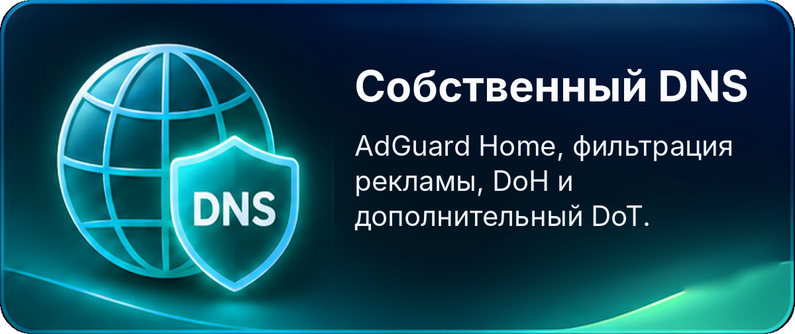</a>

</div>

### Что вы получаете

- **Готовый прокси-сервер без ручной настройки.** REALITY, XHTTP и Hysteria2 уже настроены, в конце установки вы получаете адрес панели, а при создании первого клиента - ссылку подписки. WebSocket, Trojan gRPC, XTLS Vision, AmneziaWG и XHTTP для CDN добавляются по выбору. Всё работает на nginx и Xray, без Docker и дополнительных веб-серверов.
- **Полноценные сайты-прикрытия.** Вместо стандартной заглушки на ваших доменах открываются многостраничные сайты с навигацией, статьями и иллюстрациями. Не менее 2592 вариантов оформления и текста. Hysteria2 отвечает тем же сайтом на обычные HTTP/3-запросы.
- **Управление сервером из одного меню.** Меняйте домены панели и REALITY без переустановки, создавайте резервные копии, подключайте каскад и смотрите адреса своих сервисов. Сертификаты Let's Encrypt продлеваются автоматически без остановки nginx.
- **Каскад, маршрутизация и резервирование.** Соединяйте VPS в разных странах, направляйте российский трафик напрямую с входного сервера, остальной подходящий трафик через выходной. Добавляйте собственные исходящие серверы, правила и балансировщики.
- **Резервные копии и перенос клиентов.** Полный Backup v3 восстанавливает прежнюю конфигурацию. При переходе на новую версию можно отдельно перенести клиентов, их сроки и лимиты, а также прежние пути подписок. При успешном переносе, сохранении домена панели и нужных типов подписок пользователям не придётся менять их URL.
- **Защита VPS.** Панель и подписки доступны по HTTPS без открытия внутренних служебных портов. UFW учитывает SSH-доступ, а nginx ограничивает интенсивные запросы к публичным сайтам, не затрагивая прокси-подключения. Дополнительно можно включить Fail2ban, шифрованный системный DNS и автоматические обновления безопасности.
- **Личный DNS и Telegram WEB-прокси.** AdGuard Home помогает блокировать рекламу и отслеживание на ваших устройствах через DoH и дополнительный DoT. Отдельный Telegram Web Proxy Manager доступен прямо из главного меню, в том числе для установки с выходом через каскад.

**Проект полностью бесплатный.** Все функции доступны без обязательных подписок и платных ограничений.

<p align="center">
<a href="docs/SUPPORT.md">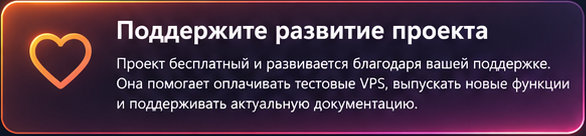</a>
</p>

## 📚 С чего начать

| Ваша задача | Руководство |
| --- | --- |
| Установить проект впервые | [Первый запуск](https://xpromsx.github.io/3x-ui-auto-nginx/start/) |
| Получить новые функции последнего релиза | [Обновление проекта](https://xpromsx.github.io/3x-ui-auto-nginx/guides/update/) |
| Сохранить или перенести данные | [Backup, Restore и клиенты](https://xpromsx.github.io/3x-ui-auto-nginx/guides/backup/) |
| Настроить цепочку из двух VPS | [Каскад](https://xpromsx.github.io/3x-ui-auto-nginx/guides/cascade/) |
| Поднять свой Telegram-прокси | [Telegram WEB-прокси](https://xpromsx.github.io/3x-ui-auto-nginx/guides/telegram-web-proxy/) |

[Все гайды и инструкции](https://xpromsx.github.io/3x-ui-auto-nginx/guides/) · [Последний релиз](https://github.com/xPROMSx/3x-ui-auto-nginx/releases/latest)

<a id="installation"></a>
<a id="-quick-start"></a>
<a id="quick-start"></a>

## 🚀 Быстрый старт

**Понадобятся:**
- Чистый VPS с Ubuntu 24.04, 26.04 или Debian 13.
- Два разных домена или поддомена с DNS-записями на IP VPS: для панели и REALITY.
- Доступные входящие TCP/80, TCP/443 и UDP/443. Дополнительно TCP/853 только для DoT.
- SSH-доступ с правами root. Если вошли под обычным пользователем с sudo, выполните на VPS `sudo -i`.

Если это первый сервер, начните с [подробной инструкции установки](https://xpromsx.github.io/3x-ui-auto-nginx/start/), включая подготовку доменов и первое подключение.

> [!CAUTION]
> Пункт **«1. Установка»** на работающем VPS удаляет прежнюю управляемую конфигурацию. Чтобы перейти на новую версию с сохранением клиентов, сначала сохраните Backup вне VPS и прочитайте [руководство по обновлению](https://xpromsx.github.io/3x-ui-auto-nginx/guides/update/).

**На VPS от root** выполните:

```bash
curl -fSL https://github.com/xPROMSx/3x-ui-auto-nginx/releases/latest/download/x-ui-latest.sh -o x-ui-latest.sh && bash x-ui-latest.sh
```

Выберите язык (**2 - Русский**) и **1 - Установка**, если VPS чистый. После завершения сохраните данные панели и ссылку подписки, подключитесь с устройства и проверьте доступ к интернету.

### Один менеджер для управления сервером

<p align="center">
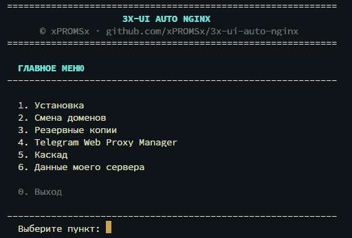
</p>

Пункты меню позволяют установить проект, поменять домены, создать или восстановить Backup, подключить каскад, установить Telegram WEB-прокси и посмотреть адреса действующих сервисов. Пункт 6 показывает адреса панели, подписок и AdGuard Home, логины, но не пароли. Повторный запуск скрипта без параметров открывает менеджер. Нужен интерактивный SSH-терминал.

<details>
<summary><strong>Резервная загрузка - если GitHub Releases недоступен</strong></summary>

Ветка `main` содержит альфа-версию проекта. Устанавливать её не рекомендуется. Для обычной установки используйте стабильный релиз по основной команде выше.

```bash
curl -fSL https://raw.githubusercontent.com/xPROMSx/3x-ui-auto-nginx/main/x-ui-latest.sh -o x-ui-latest.sh && bash x-ui-latest.sh
```

</details>

### Что выбрать при установке

Установщик задаёт семь основных вопросов. Для большинства пользователей подходят следующие ответы:

| № | Вопрос | Рекомендация |
| --- | --- | --- |
| 1 | Домен панели | Ваш первый домен |
| 2 | Домен REALITY | Ваш второй домен |
| 3 | Расширенная безопасность VPS | `Y` |
| 4 | Дополнительные подключения | `N`, если пока не нужны |
| 5 | Российские сайты через WARP | `Y` для одиночного VPS, **`N` для входного VPS каскада** |
| 6 | AdGuard Home | `N`, если не нужен личный DNS |
| 7 | Клиент и подписка | `Y` при первой установке, `N` при переносе клиентов |

[Пояснения ко всем вопросам установщика](https://xpromsx.github.io/3x-ui-auto-nginx/start/).

<details>
<summary><strong>Домены, параметры запуска и дополнительные опции</strong></summary>

<a id="1--3x-ui-panel-domain"></a>

### 1. 🌐 Домен панели 3X-UI

Адрес панели, подписок и дополнительных HTTPS-сервисов.

<a id="2--домен-vless-reality"></a>
<a id="2--vless-reality-domain"></a>
<a id="2-️-vless-reality-domain"></a>

### 2. 🛰️ Домен VLESS REALITY

Отдельный домен для подключения REALITY. Оба домена должны указывать на VPS.

**Внимание:** запуск с параметрами сразу начинает установку. На работающем VPS не используйте его без подготовки к переустановке и Backup вне VPS. На чистом VPS можно передать домены заранее:

```bash
bash x-ui-latest.sh -subdomain panel.example.com -reality_domain reality.example.com
```

Замените примеры своими доменами. Выбор языка и главное меню пропускаются; остальные вопросы остаются интерактивными.

<a id="3--enhanced-vps-security"></a>

### 3. 🔐 Расширенная безопасность VPS

При выборе `Y` настраиваются Fail2ban, шифрованный DNS самого VPS и автоматические обновления безопасности. Обновление списков пакетов в 02:30, установка обновлений в 02:50, при необходимости перезагрузка в 04:38 по местному времени VPS, **в том числе при активных подключениях**. При подходящих условиях создаётся swap 1 ГиБ независимо от этого выбора. SSH-аутентификация не меняется. [Настройки безопасности](https://xpromsx.github.io/3x-ui-auto-nginx/guides/security/).

### 4. 🧩 Дополнительные подключения

REALITY, XHTTP и Hysteria2 создаются всегда. При выборе `Y` установщик предложит остальные варианты по отдельности.

#### 4.1. WebSocket и Trojan gRPC

Создаются вместе, включёнными, если выбрана эта опция.

<a id="4--vless-xtls-vision"></a>

#### 4.2. 🔗 VLESS XTLS Vision

Требует третьего домена с DNS-записью на VPS. Сертификат и nginx настраиваются автоматически.

<a id="5--amnezia-wg"></a>

#### 4.3. 🔑 Amnezia WG

AmneziaWG 3.1 использует UDP/8443. Правило UFW добавляется автоматически. Создайте отдельного клиента в панели и получите конфигурацию для Amnezia. Первый клиент установщика не включает AmneziaWG.

<a id="xhttp-cdn"></a>

#### 4.4. 🌐 VLESS + XHTTP для CDN

> `Добавить дополнительное подключение XHTTP, совместимое с CDN? [y/N]:`

По умолчанию включено дополнительное шифрование VLESS ML-KEM-768 native между клиентом и Xray с поддержкой Vision. Клиентскому ядру нужна поддержка VLESS Encryption; шифрование можно отключить в панели.

*Дополнительное подключение · По умолчанию не устанавливается (`N`)*

Создаётся отдельное VLESS-подключение с транспортом XHTTP в режиме packet-up, предварительно настроенное для работы через CDN. Подключение создаётся выключенным в панели 3X-UI.

Используется существующий HTTPS-домен панели, поэтому дополнительный домен и сертификат не требуются. После включения подключение можно использовать напрямую, без CDN.

Для работы через CDN пользователь самостоятельно настраивает своего CDN-провайдера и изменяет параметры Host в 3X-UI. Установщик не настраивает CDN, а предоставляет готовый серверный профиль для дальнейшего использования.

---

<a id="warp-ru"></a>

### 5. 🌐 Российские сайты через Cloudflare WARP

Выбор `Y` создаёт исходящее `warp-masque` и правила для российских направлений и отдельных сервисов. Это не системный VPN: только соответствующий правилам трафик Xray выходит через Cloudflare. Установщик регистрирует устройство в Cloudflare и принимает условия сервиса. **На входном VPS каскада выбирайте N**; на выходном WARP разрешён. В русском меню по умолчанию Y, в английском N. [Подключения и WARP](https://xpromsx.github.io/3x-ui-auto-nginx/guides/connections/).

<a id="7--adguard-home--dns-over-https"></a>
<a id="6--adguard-home--dns-over-https"></a>

### 6. 🛡️ AdGuard Home + DNS-over-HTTPS и DNS-over-TLS

Личный DNS для устройств с фильтрацией рекламы. Использует домен панели, отдельный домен не нужен. Адрес DoH и данные панели показываются после установки; сохраняйте пароль. Позже адреса доступны в пункте «6. Данные моего сервера». Для доступа настройте ClientID. [Руководство по AdGuard Home](https://xpromsx.github.io/3x-ui-auto-nginx/guides/dns/).

#### 6.1. DNS-over-TLS (DoT)

Подходит для «Частного DNS» Android, дополнительно открывает TCP/853. **DoT доступен всем, кто знает адрес сервера:** nginx передаёт запросы от 127.0.0.1, ClientID не работает. Если нужен только DoH, оставьте N. [Настройка и отключение DoT](https://xpromsx.github.io/3x-ui-auto-nginx/guides/dns/#device-dot).

<a id="7--automatic-client-and-subscription"></a>
<a id="7--автоматическое-создание-клиента-и-подписки"></a>
<a id="8--автоматическое-создание-клиента-и-подписки"></a>

### 7. 👤 Автоматическое создание клиента и подписки

Выберите Y для первого клиента или N, если собираетесь восстановить клиентов из Backup. Ссылку подписки добавьте в совместимое приложение.

</details>

После установки сохраните данные панели, подписку и адреса дополнительных сервисов в защищённом месте. Если установщик сообщит о необходимости первоначальной перезагрузки, выполните её вручную в подходящее время.

<a id="installation-vs-update"></a>
<a id="установка--не-обновление"></a>

## 🔄 Обновление проекта и переход на новую версию

Чтобы получить новые функции менеджера, достаточно скачать актуальный скрипт и открыть нужный пункт. Панель 3x-ui и Xray можно обновлять штатными средствами панели с учётом совместимости; пакеты ОС - средствами системы.

**Автоматического обновления всей конфигурации поверх старой установки пока нет.** Для получения новых возможностей проекта:

1. Создайте Backup, скачайте архив вне VPS и сохраните собственные исходящие, правила маршрутизации и другие изменённые настройки.
2. Переустановите проект на текущем или новом VPS. Более чистый вариант - предварительно переустановить ОС.
3. В меню **3. Резервные копии → 4. Восстановить клиентов и подписки** выберите сохранённый архив.
4. Восстановите индивидуальные настройки, обновите подписки и проверьте подключение.

> [!IMPORTANT]
> Переустановка требует подтверждения `YES` и удаляет прежнюю базу панели и управляемую конфигурацию nginx. Полный Restore старого Backup возвращает прежние настройки, а не все функции нового релиза.

**[Пошаговый гайд: обновление проекта и перенос клиентов](https://xpromsx.github.io/3x-ui-auto-nginx/guides/update/)** объясняет, что сохранять, какой вариант переустановки выбрать и как вернуть маршрутизацию и дополнительные сервисы.

<a id="cover-sites"></a>

## 🌐 Сайты-прикрытия и HTTP/3

При установке проект автоматически создаёт **полноценные многостраничные сайты** на доменах панели и REALITY, а для дополнительного XTLS Vision - отдельный сайт. Не менее 2592 вариантов оформления и текста, работающая навигация, иллюстрации, адаптация под мобильные устройства. Названия, палитры и содержимое персонализируются при установке.

Обычные HTTPS-запросы и неавторизованные HTTP/3-запросы Hysteria2 на домене REALITY получают один и тот же сайт. Панель и подписки не доступны через публичное HTTP/3-прикрытие. Выбранный сайт сохраняется при Backup/Restore и смене доменов.

**Защита от интенсивных HTTP-запросов.** Начиная с v2.9.0 на новых установках nginx автоматически ограничивает запросы к управляемым публичным сайтам: 20 запросов в секунду с одного IP на сайт и 200 суммарно на сайт, с допустимыми кратковременными всплесками. При превышении лимита возвращается HTTP 429 со страницей в стиле сайта. Ограничения не распространяются на прокси-подключения, панель, подписки, AdGuard Home и Telegram WEB-прокси. Это не замена полноценной защите от DDoS.

<a id="-connection-profiles"></a>
<a id="connection-profiles"></a>

## 🚀 Профили подключения

| Подключение | Когда создаётся |
| --- | --- |
| VLESS + REALITY | ✅ Всегда, включено |
| VLESS + XHTTP | ✅ Всегда, включено |
| Hysteria2 | ✅ Всегда, включено |
| VLESS + WebSocket (TLS) | По выбору |
| Trojan + gRPC | По выбору |
| VLESS + XTLS Vision | По выбору, третий домен |
| AmneziaWG | По выбору, отдельный клиент |
| VLESS + XHTTP для CDN | По выбору, выключено до настройки |

[Разобраться в подключениях, nginx и WARP](https://xpromsx.github.io/3x-ui-auto-nginx/guides/connections/). Совместимость зависит от приложения и сети; включать все дополнительные профили необязательно.

<a id="subscriptions"></a>

### Подписки

Одна персональная HTTPS-ссылка содержит поддерживаемые профили клиента. После изменения настроек достаточно обновить подписку в приложении. Доступны обычные подписки, JSON и Mihomo/Clash (в зависимости от настроек панели); `provider=1` возвращает исходную подписку для proxy providers.

<a id="change-domains"></a>

## 🌐 Смена доменов

В главном меню выберите **2 - Смена доменов**. Можно поменять домен панели, REALITY или оба без переустановки. Новые домены должны указывать на текущий VPS, TCP/80 должен быть доступен для сертификатов. Прежние домены могут уже не разрешаться в DNS или указывать на другой сервер.

Менеджер сам создаст Backup v3, подготовит сертификаты и изменит конфигурацию, сохранив клиентов, настройки и статистику. Домен Vision остаётся прежним. После смены обновите затронутые ссылки подписок, профили и адрес DNS.

[Пошаговая смена доменов](https://xpromsx.github.io/3x-ui-auto-nginx/guides/domains/) · [Технические подробности и восстановление](docs/MANAGER.md#change-domains). При сообщении `ROLLBACK_UNVERIFIED` остановитесь, сохраните Backup и данные восстановления.

<a id="backup--restore"></a>

## 💾 Backup / Restore

Все операции доступны через пункт **3 - Резервные копии**. Архивы Backup v3 находятся в `/var/backups/x-ui/`. Сохраните копию за пределами VPS: архив содержит пароли, приватные ключи и данные клиентов.

| Что вы хотите сделать | Руководство |
| --- | --- |
| Создать и скачать Backup | [Резервная копия](https://xpromsx.github.io/3x-ui-auto-nginx/guides/backup/#create-backup) |
| Вернуть прежнее состояние или перенести весь стек | [Полное восстановление](https://xpromsx.github.io/3x-ui-auto-nginx/guides/backup/#full-restore) |
| Сохранить пользователей и прежние пути подписок на свежей установке | [Перенос клиентов](https://xpromsx.github.io/3x-ui-auto-nginx/guides/backup/#import-clients) |
| Получить возможности нового релиза | [Переход на новую версию](https://xpromsx.github.io/3x-ui-auto-nginx/guides/update/) |

<a id="restore-on-new-vps"></a>
<a id="recovery-on-a-new-vps"></a>

### Восстановление на новом VPS

Для полного Restore нужны те же ОС, её версия и архитектура, что в архиве. Загрузите Backup на чистый VPS, скачайте актуальный менеджер и выберите **3. Резервные копии → 3. Восстановить резервную копию**. Не устанавливайте проект предварительно. Менеджер подготовит компоненты и восстановит стек. При необходимости направьте прежние домены на новый IP. Перед полным Restore сохраните все важные данные целевого VPS.

На чистой ОС менеджер дождётся автоматических обновлений системы (до 60 минут); не перезагружайте VPS в этот момент. Восстанавливайте только собственные доверенные архивы. TWPM обслуживается отдельно; полный Restore блокируется на целевом VPS с установленным TWPM. Современный Restore поддерживает Backup v3. Для архивов v2 нужна утилита соответствующего старого релиза.

<details>
<summary><strong>Команды для опытных пользователей и аварийное извлечение</strong></summary>

Если утилита уже установлена, **на VPS от root**:

```bash
x-ui-backup backup
x-ui-backup list
```

**Внимание:** полный Restore заменяет управляемые данные. В отличие от меню, команда не включает UFW и не выполняет дополнительные настройки Security. Для восстановления выбранного доверенного архива:

```bash
x-ui-backup restore /var/backups/x-ui/ИМЯ_АРХИВА.tar.gz
```

Если Restore невозможен, извлеките файлы в новый каталог без запуска служб и установки пакетов:

```bash
x-ui-backup extract /path/to/archive.tar.gz ./recovered-backup
```

Нужны Bash, Python 3 и права доступа к архиву и каталогу; root не обязателен. Исходные пути сохраняются в `files/`, ссылки пропускаются. Не копируйте извлечённые секреты и старые конфигурации поверх работающего сервера без проверки.

</details>

### Восстановление клиентов и подписок

При новой установке создаются случайные пути RAW и JSON. Пункт **4. Восстановить клиентов и подписки** возвращает прежние пути из Backup v3 и переносит клиентские идентификаторы, учётные данные, состояние, сроки, лимиты и поддерживаемые счётчики. При сохранении домена панели и типов подписок после успешного переноса прежние URL работают.

Клиенты привязываются ко всем подходящим активным локальным входящим новой установки, а не к прежним индивидуальным входящим. Проверьте привязки. Серверные ключи, настройки подключений, исходящие, маршрутизация и другие компоненты остаются новыми. Для AmneziaWG используются адреса текущей подсети. Существующие клиенты с совпадающим email или идентификатором подписки не перезаписываются; при `PARTIAL` проверьте отчёт.

[Перенос клиентов и подписок](https://xpromsx.github.io/3x-ui-auto-nginx/guides/backup/#import-clients) · [Полный гайд по обновлению](https://xpromsx.github.io/3x-ui-auto-nginx/guides/update/)

<a id="cascade"></a>

## 🔗 Каскад из двух серверов

<p align="center">
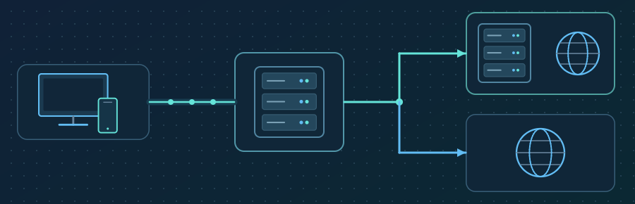
<br><sub>Маршрутизация по умолчанию: оранжевый сплошной маршрут - через выходной VPS, голубой пунктирный - напрямую к российским ресурсам.</sub>
</p>

Соедините два VPS в цепочку. Устройства продолжают подключаться к входному серверу, а Xray выбирает дальнейший маршрут. По умолчанию российские домены и IP из геобаз идут напрямую, остальной подходящий трафик - через выходной VPS. Настройка доступна из пункта **5 - Каскад**.

На входном VPS WARP должен быть отключён, на выходном допустим. AmneziaWG не передаётся через каскад; QUIC на UDP/443 через Vision не проходит. Более ранние пользовательские правила могут изменить маршрут. При недоступности выхода автоматического резерва нет, пока не настроен балансировщик.

| Что настроить | Руководство |
| --- | --- |
| Соединить два VPS | [Каскад из двух VPS](https://xpromsx.github.io/3x-ui-auto-nginx/guides/cascade/) |
| Добавить другой сервер через REALITY или XHTTP | [Добавляем исходящий сервер](https://xpromsx.github.io/3x-ui-auto-nginx/guides/import-reality/) |
| Выбирать маршруты для сайтов, клиентов и входящих | [Маршрутизация трафика](https://xpromsx.github.io/3x-ui-auto-nginx/guides/routing/) |
| Переключаться на запасной выход при отказе | [Балансировщик и резервный VPS](https://xpromsx.github.io/3x-ui-auto-nginx/guides/balancer/) |

<details>
<summary><strong>Краткая настройка, состояние и отключение</strong></summary>

### Что потребуется

Два работающих VPS проекта, доступ к обеим панелям, актуальный менеджер. Перед изменениями сохраните Backup. На входном VPS не должно быть WARP.

### 1. Создать ключ на выходном сервере

Откройте **5. Каскад → 1. Создать ключ (выходной сервер)**, введите данные панели. Менеджер создаст отдельного клиента `cascade` и выдаст секретную ссылку `vless://`. Скопируйте её, не публикуйте.

### 2. Подключить входной сервер

На входном VPS выберите **5. Каскад → 2. Подключить выходной сервер (входной сервер)**, введите данные его панели и вставьте ключ. Менеджер проверит связь и добавит `cascade-exit` и три правила CASCADE. Применение может ненадолго прервать подключения; при ошибке менеджер сообщит результат отката.

### 3. Проверить состояние

На обоих VPS откройте **5. Каскад → 3. Состояние**. Затем проверьте внешний IP на устройстве, подключённом через входной VPS.

### 4. Отключить Каскад

Сначала отключите входную роль через **5. Каскад → 4. Отключить**. Если выходной клиент `cascade` больше не нужен другим серверам, отключите и выходную роль. При наличии зависимого балансировщика предварительно уберите зависимости по [руководству](https://xpromsx.github.io/3x-ui-auto-nginx/guides/balancer/).

### Что нужно знать

После смены доменов выходного VPS может понадобиться повторное соединение. Если выход недоступен, проверьте состояние сервера и маршрутизацию; не переустанавливайте весь стек.

### Резервные копии

Полный Backup сохраняет каскад. При переносе только клиентов каскад настраивается заново. После восстановления проверьте связь между VPS.

</details>

<a id="-security"></a>
<a id="security"></a>

## 🔐 Безопасность

Служебные интерфейсы доступны через nginx и HTTPS, внутренние порты не открываются напрямую. Сетевой экран UFW учитывает SSH-доступ перед включением. При расширенной безопасности настраиваются Fail2ban, защищённый DNS самого VPS и автоматические обновления безопасности; плановая перезагрузка при необходимости может прервать подключения. Сертификаты Let's Encrypt продлеваются автоматически без остановки nginx.

[Подробное руководство по безопасности VPS](https://xpromsx.github.io/3x-ui-auto-nginx/guides/security/).

**Защитите SSH-доступ самостоятельно.** Установщик не отключает парольный вход, чтобы не лишить вас доступа:
- [Настройте SSH-ключи](https://xpromsx.github.io/3x-ui-auto-nginx/guides/ssh-keys/) через Termius или PowerShell.
- Проверьте новый вход по ключу и только затем [отключите парольный вход](https://xpromsx.github.io/3x-ui-auto-nginx/guides/ssh-password/).

### Личный DNS

AdGuard Home блокирует запросы к известным рекламным и отслеживающим доменам, позволяет вести журнал и выбирать DNS-провайдеров. Его можно включить при установке. Используйте персональные ClientID для DoH; DoT на TCP/853 не имеет такой индивидуальной авторизации и доступен извне. [Настроить личный DNS и частный DNS Android](https://xpromsx.github.io/3x-ui-auto-nginx/guides/dns/).

<a id="telemt-web-manager"></a>
<a id="telegram-web-proxy-manager"></a>

## ✈️ Telegram Web Proxy Manager

[Telegram Web Proxy Manager](https://github.com/xPROMSx/telegram-web-proxy-manager) - наш отдельный бесплатный проект для установки Telegram WEB-прокси на Ubuntu 24.04/26.04. Настоящий HTTPS, Telemt, полноценный сайт-прикрытие и обновление Telemt с откатом. В 3X-UI открывается через пункт **4 - Telegram Web Proxy Manager**; для подтверждения первой установки достаточно Enter.

TWPM не входит в базовую установку и управляется отдельно. Выберите свой сценарий:

- [Обычная установка на VPS](https://xpromsx.github.io/3x-ui-auto-nginx/guides/telegram-web-proxy/#direct-install).
- [Установка на российском VPS с выходом через зарубежный сервер](https://xpromsx.github.io/3x-ui-auto-nginx/guides/telegram-web-proxy/#cascade-socks).

<a id="technical-details"></a>

<a id="-technical-details-and-compatibility"></a>
<a id="technical-details-and-compatibility"></a>

<a id="️-technical-details-and-compatibility"></a>

## ⚙️ Технические подробности и совместимость

- **ОС:** Ubuntu 24.04, Ubuntu 26.04 и Debian 13.
- **UFW:** разрешаются 80/tcp, 443/tcp и 443/udp (8443/udp - при выборе AmneziaWG, 853/tcp - при выборе DoT). При установке UFW включается только после проверки SSH-доступа; если сделать это безопасно нельзя, остаётся выключенным с предупреждением. После Restore через меню его можно включить **только по отдельному выбору** и после проверок безопасности; обычная команда `x-ui-backup restore` UFW не включает.
- **Сертификаты:** Let's Encrypt webroot и `certbot.timer` продлевают сертификаты автоматически, без остановки nginx.
- **Версия 3x-ui:** по умолчанию устанавливается последняя версия, тщательно протестированная на совместимость с 3X-UI AUTO NGINX. После установки вы можете самостоятельно обновить 3x-ui штатными средствами панели, но совместимость новой версии с нашей конфигурацией может быть ещё не подтверждена. Другой стабильный релиз можно явно выбрать через `-version <tag>` (минимальная поддерживаемая версия — v3.8.0); установщик предупредит о неподтверждённой совместимости.

<a id="-credits--origins"></a>
<a id="credits--origins"></a>

## 🤝 Происхождение и авторы

Проект основан на [3x-ui-pro](https://github.com/mozaroc/3x-ui-pro) (автор mozaroc). Тот возник из форка [x-ui-pro](https://github.com/mozaroc/x-ui-pro) и восходит к исходному [x-ui-pro](https://github.com/GFW4Fun/x-ui-pro) от GFW4Fun. Сейчас проект развивается независимо. После создания форка существенно переработаны маршрутизация nginx/SNI и конфигурация XHTTP, механизм выпуска и автоматического продления TLS-сертификатов, а также Backup / Restore v3 с восстановлением и откатом. Добавлен Hysteria2 на UDP/443 и устранены выявленные проблемы безопасности.

Панель предоставляет [MHSanaei/3x-ui](https://github.com/MHSanaei/3x-ui). Права авторов сторонних компонентов и существующие лицензии сохраняются.

Собственные разработки и изменения xPROMSx распространяются под [GNU GPL-3.0-only](LICENSE). Copyright (C) 2026 xPROMSx contributors. Лицензия охватывает только наши права на эти материалы; она не перелицензирует унаследованный код и не подтверждает GPL-статус всего репозитория. Область действия нашей лицензии и сведения о сторонних компонентах приведены в [THIRD_PARTY_NOTICES.md](THIRD_PARTY_NOTICES.md).

**Если вы хотите взять наш код.** Чтобы просто установить и пользоваться проектом, ничего делать не нужно: он бесплатный, как и раньше. Если вы публикуете свою версию или переносите наш код в другой проект, оставьте ссылку `© xPROMSx · github.com/xPROMSx/3x-ui-auto-nginx` в README и на стартовом экране или в главном меню установщика и честно напишите, что версия изменена. Не выдавайте нашу работу за свою. Точные условия: [docs/NOTICE.md](docs/NOTICE.md).

Если вы хотите распространять, переводить или адаптировать наши статьи, ознакомьтесь с [условиями использования материалов проекта](https://xpromsx.github.io/3x-ui-auto-nginx/terms/).

<a id="windows-flag-emojis"></a>

## 🖥️ Флаги стран в Windows 11

Если при открытии панели **3x-ui** в **Chrome, Edge или Brave** на Windows 11 вместо флагов стран отображаются буквенные коды (`FI`, `DE`, `US`), воспользуйтесь нашим небольшим проектом [**Flag Emojis Windows Installer**](https://github.com/xPROMSx/flag-emojis-windows-installer). Он помогает вернуть отображение флагов, сохраняет оригинальный шрифт Windows и имеет возможность отката.

<a id="-поддержать-разработку"></a>
<a id="-support-development"></a>
<a id="support-development"></a>
<a id="️-support-development"></a>

## ❤️ Поддержать разработку

3X-UI AUTO NGINX и его документация полностью бесплатны. Работа над проектом включает разработку функций, проверки на разных ОС и реальных VPS, исправление ошибок, обновление компонентов и подготовку руководств. Поддержка пользователей помогает продолжать эту работу.

<div align="center">

[](https://pay.cloudtips.ru/p/9f240c8b)
[](https://web.tribute.tg/d/S0p)
[](docs/SUPPORT.md)

</div>

- **Россия:** СБП, Мир, приложение банка через CloudTips.
- **Другие страны:** Tribute (банковская карта).
- **Криптовалюта:** [USDT, USDC, GRAM и Bitcoin](docs/SUPPORT.md#cryptocurrency).

Если сейчас не можете поддержать финансово, [поставьте Star](https://github.com/xPROMSx/3x-ui-auto-nginx), поделитесь проектом или сообщите об ошибке. Спасибо всем, кто помогает развивать 3X-UI AUTO NGINX.

<div align="center">

**Два домена. Несколько минут. Собственный 3x-ui / Xray сервер.**

[Установка](#installation) · [Обновление](#installation-vs-update) · [Документация](https://xpromsx.github.io/3x-ui-auto-nginx/) · [Релизы](https://github.com/xPROMSx/3x-ui-auto-nginx/releases) · [Ошибки](https://github.com/xPROMSx/3x-ui-auto-nginx/issues)

</div>
