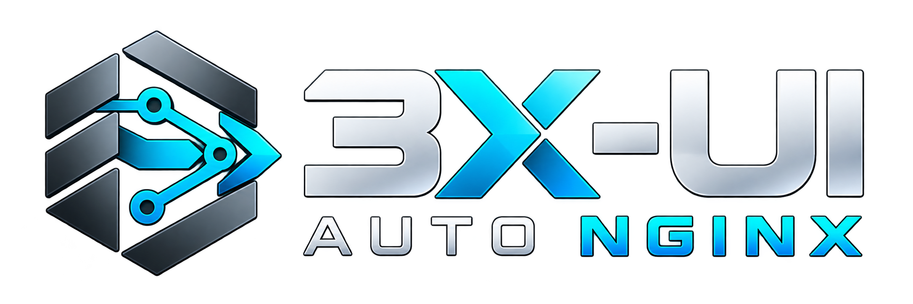
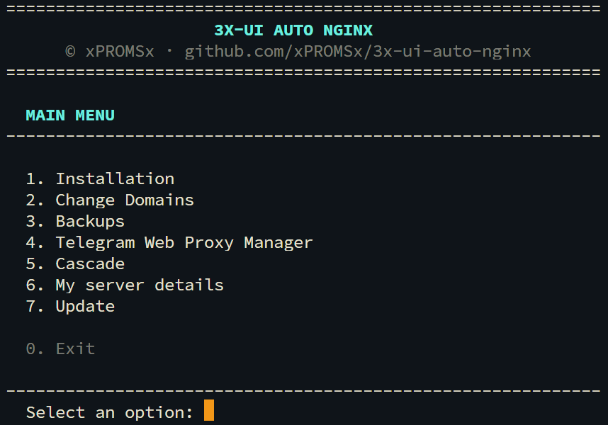

<div align="center">

[🇷🇺 Русский](README.md) · [🇬🇧 English](README_EN.md) · 🇪🇬 **العربية** · [🇮🇷 فارسی](README_FA.md) · [🇨🇳 简体中文](README_ZH_CN.md) · [🇪🇸 Español](README_ES.md) · [🇹🇷 Türkçe](README_TR.md)

<h1 align="center"></h1>

### نشر 3X-UI / XRAY-CORE تلقائيًا على خادم VPS الخاص بك

**REALITY · XHTTP · HYSTERIA2 · CASCADE · ADGUARD HOME · UPDATE · BACKUP / RESTORE**

نطاقان وخادم VPS جديد وبضع دقائق لإكمال التثبيت.

[](https://github.com/xPROMSx/3x-ui-auto-nginx/releases)
[](https://github.com/xPROMSx/3x-ui-auto-nginx/releases)
[](#technical-details)
[](#technical-details)
[](docs/SUPPORT_AR.md)

[📦 الإصدارات](https://github.com/xPROMSx/3x-ui-auto-nginx/releases) · [🔗 الربط المتسلسل](#cascade) · [🌐 مواقع التمويه](#cover-sites) · [✈️ Telegram Web Proxy Manager](#telemt-web-manager) · [❤️ دعم المشروع](#support-development) · [💬 التواصل](https://t.me/promsdev) · [🔄 التحديث](#installation-vs-update)

[📚 موقع التوثيق (باللغة الروسية)](https://xpromsx.github.io/3x-ui-auto-nginx/)

</div>

**3X-UI AUTO NGINX** أداة مجانية لتثبيت [3x-ui](https://github.com/MHSanaei/3x-ui) وXray على VPS خاص بك. أدخل نطاقين وشغّل أمرًا واحدًا. يجهّز المثبّت Nginx وشهادات HTTPS واتصالات REALITY وXHTTP وHysteria2 ورابط الاشتراك وموقع التمويه. ومن القائمة يمكنك تغيير النطاقات، إدارة النسخ الاحتياطية، إعداد اتصال متسلسل بين خادمين وتشغيل خادم DNS شخصي. يمكن الآن تحديث التثبيتات المتوافقة مباشرةً دون إعادة تثبيت الخادم.

**مواقع تمويه بدل الصفحة الافتراضية:** ينشئ كل تثبيت مواقع متعددة الصفحات مع تنقّل ومقالات وصور. هناك 2592 نموذجًا على الأقل. وتظهر صفحات التمويه نفسها لطلبات Hysteria2 غير المصادَق عليها عبر HTTP/3. لا حاجة إلى Docker أو خادم ويب إضافي.

## ✨ لماذا هذا المشروع؟

| | |
| --- | --- |
| **جاهز خلال دقائق**<br>نطاقان وVPS نظيف وأمر واحد. تحصل على عنوان اللوحة ورابط الاشتراك مع REALITY وXHTTP وHysteria2 مهيأة. | **يبدو كأنه موقع عادي**<br>مواقع متعددة الصفحات بتصاميم ونصوص وصور متنوعة، 2592 احتمالًا على الأقل، مع تمويه Hysteria2 عبر HTTP/3. |
| **اتصال متسلسل بين خادمين**<br>تتصل أجهزتك بخادم الدخول ويخرج المرور إلى الإنترنت عبر خادم آخر، مثل خادم في بلد مختلف. الإعداد من القائمة. | **DNS خاص لحظر الإعلانات**<br>يحجب AdGuard Home الإعلانات والتتبّع. تتصل الأجهزة عبر DNS-over-HTTPS (DoH) أو DNS-over-TLS (DoT) الاختياري. |
| **التحديث والنسخ الاحتياطي**<br>حدّث التثبيتات المتوافقة من v3.0.0 دون إعادة التثبيت. يستعيد Backup v3 المنظومة المُدارة كاملةً، ويمكن نقل العملاء والاشتراكات فقط إلى تثبيت جديد. | **أمان دون تعقيد**<br>تعمل اللوحة والاشتراكات عبر HTTPS، وتبقى المنافذ الداخلية محلية، وتتجدد الشهادات تلقائيًا. يمكن تفعيل حماية SSH وتحديثات VPS الأمنية. |

**الأساسيات فقط افتراضيًا.** تُثبّت الاتصالات الثلاثة الرئيسية تلقائيًا. أما WebSocket وTrojan gRPC وXTLS Vision وAmneziaWG وXHTTP لشبكات CDN فلا تُنشأ إلا عند اختيارها. لا يلزم Docker أو خادم ويب آخر.

<a id="installation"></a>

## 🚀 بدء التثبيت

استخدم VPS جديدًا يعمل بنظام Ubuntu 24.04 أو Ubuntu 26.04 أو Debian 13، واتصل عبر SSH بحساب **root**. وجّه نطاقين إلى عنوان IP للخادم، أحدهما للوحة والآخر لـ REALITY. يجب إتاحة TCP **80** و**443** وUDP **443** من الإنترنت. وإذا اخترت DoT، يلزم أيضًا TCP **853**. [التفاصيل التقنية](#technical-details).

إذا كان المشروع مثبتًا بالفعل، اقرأ [تحديث المشروع](#installation-vs-update) قبل اختيار Installation.

```bash
curl -fSL https://github.com/xPROMSx/3x-ui-auto-nginx/releases/latest/download/x-ui-latest.sh -o x-ui-latest.sh && bash x-ui-latest.sh
```

بعد تشغيل السكربت اختر **1 — English** أو **2 — Русский**، ثم ستظهر القائمة الرئيسية:

<p align="center">
  
</p>

- **1 — Installation:** إعداد خادم جديد أو إعادة التثبيت بالكامل.
- **2 — Change Domains:** تغيير نطاق اللوحة أو REALITY أو كليهما دون إعادة تثبيت.
- **3 — Backups:** إنشاء النسخ الاحتياطية وعرضها واستعادتها، أو استعادة العملاء والاشتراكات فقط.
- **4 — Telegram Web Proxy Manager:** تشغيل مدير بروكسي Telegram المستقل أو تثبيته.
- **5 — Cascade:** ربط خادمين والتحقق من الحالة أو إيقاف الربط.
- **6 - My server details:** عرض عناوين اللوحة والاشتراكات وAdGuard Home وأسماء المستخدمين دون تغيير الإعدادات أو إظهار كلمات المرور.
- **7 — Update:** تحديث التثبيت المتوافق مباشرةً مع الحفاظ على العملاء والإعدادات.
- **0 — Exit:** خروج.

تحتاج القائمة إلى جلسة SSH مع طرفية تفاعلية.

<details>
<summary><strong>تنزيل احتياطي — إذا تعذّر الوصول إلى GitHub Releases</strong></summary>

**يحتوي فرع `main` على نسخة ألفا من المشروع.** لا يُنصح بتثبيتها. استخدم الإصدار المستقر عبر الأمر الأساسي أعلاه.

```bash
curl -fSL https://raw.githubusercontent.com/xPROMSx/3x-ui-auto-nginx/main/x-ui-latest.sh -o x-ui-latest.sh && bash x-ui-latest.sh
```

</details>

<a id="installation-vs-update"></a>

### تحديث المشروع

**التثبيتات المتوافقة من v3.0.0 فما بعد:** نزّل المدير المستقر الحالي بالأمر أعلاه، واختر **7 — Update** ثم أكّد. يتحقق المدير من التوافق، وينشئ نسخة Backup v3 ويتحقق منها قبل التغييرات، ويحدّث الإعدادات المُدارة، وعند الحاجة 3x-ui وXray إلى الإصدارات المتحقق منها. تبقى بيانات العملاء والاشتراكات والمفاتيح وإعدادات اللوحة والربط المتسلسل وقواعد التوجيه محفوظة.

تعني `SUCCESS` اكتمال التحديث، و`UP TO DATE` عدم الحاجة إليه. تحقّق من اللوحة واتصال أحد العملاء، واحتفظ بالنسخة الجديدة خارج VPS إذا أُنشئت. قد تنقطع الاتصالات لفترة قصيرة، وقد يُعاد إنشاء مواقع التمويه المُدارة أو تُستبدل التعديلات اليدوية على إعدادات Nginx أو النقل المُدارة. حدّث ملفات اتصال العملاء عند الحاجة.

يتطلب Update تثبيتًا متوافقًا (`update_contract=1`) ولا يضيف خيارات تثبيت لم تخترها. إذا كان إصدار 3x-ui أو Xray أحدث من الإصدار المتحقق منه في إصدار المشروع، يرفض Update الرجوع إلى إصدار أقدم. عند الفشل راجع الخطأ ونتيجة التراجع. إذا ظهرت `ROLLBACK UNVERIFIED`، فتوقّف واحتفظ بالنسخة الاحتياطية وملفات الاسترداد؛ لا تُعد التثبيت.

**الانتقال من 2.x إلى v3.0.0 أو أحدث، أو البدء عمدًا بإعدادات جديدة:**

1. أنشئ Backup v3 ونزّله خارج VPS. احفظ الاتصالات الصادرة وقواعد التوجيه والإعدادات المخصصة الأخرى بشكل منفصل.
2. ثبّت الإصدار الجديد على VPS الحالي أو الجديد. استخدم نطاق اللوحة السابق للاحتفاظ بروابط الاشتراك، وتجاوز إنشاء العميل تلقائيًا.
3. اختر **3 — Backups → 4 — Restore clients and subscriptions** وحدد الأرشيف.
4. أعد إعداداتك المخصصة وحدّث الاشتراكات واختبر الاتصالات.

تُستخدم الاستعادة الكاملة للعودة إلى الإعدادات المحفوظة في الأرشيف، لا لترقية المشروع.

> [!CAUTION]
> **التثبيت ليس تحديثًا!**
>
> إعادة تشغيل السكربت **دون معاملات** تفتح المدير ولا تعيد تثبيت الخادم. لكن خيار **Installation** مخصّص لخادم VPS نظيف أو لإعادة تثبيت كاملة.
>
> إذا اكتُشف تثبيت موجود، يحذّر المثبّت من حذف بيانات المشروع ويطلب إدخال **YES** حرفيًا. تستبدل إعادة التثبيت قاعدة بيانات 3X-UI وإعدادات nginx. كذلك:
> - إذا كان XTLS Vision مثبتًا سابقًا ولم تختره مرة أخرى أو اخترت نطاقًا مختلفًا، تُحذف شهادة نطاق Vision القديم التي أنشأها المثبّت. يظهر تحذير بذلك قبل طلب YES؛
> - إذا كان AmneziaWG مثبتًا ولم تختره مرة أخرى، يُغلق المنفذ 8443/udp (من دون تحذير منفصل).
>
> **احفظ نسخة Backup خارج VPS قبل المتابعة.**
>
> **Change Domains** و**Backups** عمليتان مستقلتان لا تعيدان تثبيت اللوحة.

استخدم Update للحصول على إصدارات 3x-ui وXray المتحقق منها. قد يمنع تحديثهما بشكل مستقل من اللوحة استخدام Update إلى أن يتوفر إصدار متوافق. حدّث nginx ونواة Linux وحزم النظام الأخرى بأدوات نظام التشغيل. للحصول على وظائف المدير الجديدة فقط نزّل المدير الحالي.

الأسئلة الأساسية سبعة، وقد يتبع بعضها أسئلة إضافية. الإعدادات الافتراضية مناسبة لمعظم المستخدمين.

| رقم | السؤال | الافتراضي | النتيجة |
| --- | --- | :---: | --- |
| 1 | نطاق اللوحة | - | اللوحة والاشتراكات وموقع التمويه |
| 2 | نطاق REALITY | - | اتصال REALITY وموقع التمويه |
| 3 | أمان VPS المتقدم | `Y` | Fail2ban وDNS مشفّر للخادم وتحديثات أمنية |
| 4 | الاتصالات الإضافية (اختيار منفصل) | `N` | WebSocket وTrojan gRPC وXTLS Vision وAmneziaWG وXHTTP لشبكات CDN |
| 5 | المواقع الروسية عبر WARP | `N` (الإنجليزية)، `Y` (الروسية) | إخفاء IP الخادم عن المواقع الروسية |
| 6 | AdGuard Home | `N` | DNS شخصي مع DoH وDoT اختياري |
| 7 | العميل والاشتراك | `Y` | رابط اشتراك عند اكتمال التثبيت |

الأسئلة 4.1 إلى 4.4 لا تظهر إلا إذا فعّلت الاتصالات الإضافية.

---

### 1. 🌐 نطاق لوحة 3X-UI

> `Enter the domain for your 3X-UI panel:`

أدخل النطاق الذي ستُتاح عبره لوحة الإدارة والاشتراكات وخدمات الويب الإضافية.

---

### 2. 🛰️ نطاق VLESS REALITY

> `Enter the domain for VLESS REALITY:`

أدخل نطاقًا ثانيًا لاتصال REALITY. يجب أن تشير سجلات DNS لكلا النطاقين إلى عنوان IP الخاص بخادم VPS.

<details>
<summary>ℹ️ خيارات تشغيل إضافية</summary>

يمكنك تمرير النطاقين مباشرة عبر سطر الأوامر دون إدخالهما عند ظهور الأسئلة:

```bash
bash x-ui-latest.sh -subdomain panel.example.com -reality_domain reality.example.com
```

استبدل `panel.example.com` و`reality.example.com` بنطاقيك. سيستمر اختيار الميزات الاختيارية تفاعليًا أثناء التثبيت.

</details>

---

### 3. 🔐 تعزيز أمان خادم VPS

> `Enhance VPS security? [Y/n]:`

*يُنصح به للمستخدمين الأقل خبرة · مفعّل افتراضيًا (`Y`)*

يضبط المُثبّت Fail2ban لحماية SSH وDNS مشفّرًا للنظام (DoT) والتحديثات الأمنية التلقائية. وعند توفّر الشروط المناسبة، ينشئ أيضًا ملف swap بحجم 1 GiB، بغض النظر عن اختيار الحماية الإضافية.

**اطّلع على التفاصيل التالية قبل تفعيل هذا الخيار**، وخاصة جدول إعادة التشغيل التلقائي.

<details>
<summary>🔐 تفاصيل إعدادات الأمان</summary>

يؤدي اختيار `Y` إلى تفعيل إعدادات الحماية الإضافية. ويُضبط swap بشكل مستقل عن هذا الاختيار:

- **Swap بحجم 1 GiB.** إذا لم تكن هناك مساحة swap نشطة، وكان نظام الملفات مدعومًا وتوفرت مساحة حرة لا تقل عن 4 GiB، ينشئ المُثبّت ملف swap ويُفعّله. لا تتغير إعدادات swap الحالية. إذا لم تتحقق الشروط، تُتخطى هذه الخطوة دون إيقاف التثبيت.
- **حماية SSH — Fail2ban.** الحدّ من محاولات تسجيل الدخول الفاشلة المتكررة بناءً على منافذ SSH الفعلية، دون تغيير إعدادات المصادقة الحالية. تُحفظ إعدادات حماية SSH القائمة والمتوافقة إذا كانت تعمل.
- **DNS مشفّر (DoT).** تستخدم خوادم Cloudflare وGoogle العامة DNS-over-TLS الإلزامي عبر `systemd-resolved`. تُحفظ مسارات DNS ونطاقات البحث الخاصة بالواجهات وVPN؛ وقد تبقى استعلاماتها غير مشفّرة. إذا فشل إعداد DoT واستُعيد DNS الأصلي بنجاح، يستمر تثبيت المكونات الأساسية وFail2ban والتحديثات التلقائية بشكل مستقل عن DoT؛ وتُظهر النتيجة النهائية الفشل مع رمز خروج غير صفري.
- **تحديثات أمنية تلقائية.** تحديث قوائم الحزم الساعة 02:30 وتثبيت التحديثات الأمنية الساعة 02:50.
- **إعادة التشغيل التلقائية — 04:38.** إذا تطلّبت التحديثات إعادة التشغيل، فستتم في الوقت المحدد **حتى مع وجود جلسات مستخدمين نشطة**، وقد تنقطع الاتصالات.

تُحسب المواعيد حسب المنطقة الزمنية المحلية لخادم VPS.

تُفحص إعدادات النظام الحالية للتأكد من التوافق قبل التعديل، وتتوفر آلية تراجع منضبطة عند فشل إعدادات الأمان.

**مهم:** لا يعطّل هذا الخيار تسجيل الدخول إلى SSH بكلمة مرور ولا يغني عن إدارة الخادم. اضبط الدخول بمفاتيح SSH أولًا، ثم عطّل المصادقة بكلمة المرور بنفسك.

</details>

---

### 4. 🧩 الاتصالات الإضافية

> `Set up additional connections? [y/N]:`

*معطّلة افتراضيًا (`N`)*

تُنشأ اتصالات REALITY وXHTTP وHysteria2 تلقائيًا. يمكنك اختيار WebSocket وTrojan gRPC وXTLS Vision وAmneziaWG وXHTTP لشبكات CDN أيضًا.

> [!WARNING]
> قد لا تعمل هذه الاتصالات في كل البلدان والشبكات. استخدمها على مسؤوليتك، وإذا لم تكن متأكدًا فاختر `N`.

إذا أجبت `N` فلا ينشأ أي اتصال إضافي وتُتخطّى الأسئلة 4.1 إلى 4.4. عند اختيار `y` يطلب المثبّت اختيار كل نوع على حدة.

#### 4.1. WebSocket وTrojan gRPC

> `Set up legacy VLESS WebSocket and Trojan gRPC connections? [y/N]:`

عند اختيار `y` يُنشأ الاتصالان مفعّلين، وعند `N` لا يُنشأ أي منهما.

---

<a id="4--vless-xtls-vision"></a>

#### 4.2. 🔗 VLESS XTLS Vision

> `Set up an additional VLESS TCP/TLS (XTLS Vision) connection? (requires a separate domain) [y/N]:`

*اتصال إضافي · معطّل افتراضيًا (`N`)*

اتصال VLESS بديل عبر TLS قد يكون مفيدًا إذا كان REALITY غير مستقر أو محجوبًا على شبكتك. يُضاف كملف اتصال مستقل في لوحة 3X-UI.

> [!IMPORTANT]
> **يتطلّب XTLS Vision نطاقًا ثالثًا مستقلًا** يختلف عن نطاقَي اللوحة وREALITY. يجب أن يشير سجل DNS الخاص به إلى IP الخادم. يجري إعداد شهادة HTTPS وتوجيه nginx تلقائيًا.
>
> بعد اختيار `Y`، سيطلب المُثبّت أيضًا إدخال هذا النطاق: `Enter the domain for VLESS TLS Vision (must differ from the panel and REALITY domains):`.

---

<a id="5--amnezia-wg"></a>

#### 4.3. 🔑 Amnezia WG

> `Set up an additional AmneziaWG connection? [y/N]:`

*اتصال إضافي · معطّل افتراضيًا (`N`)*

يُنشأ اتصال AmneziaWG مستقل داخل لوحة 3X-UI. لا يلزم نطاق إضافي.

<details>
<summary>ℹ️ المزيد عن Amnezia WG</summary>

يُعدّ المُثبّت AmneziaWG 3.1 عبر **UDP/8443** ويضيف قاعدة UFW المطلوبة تلقائيًا.

بعد التثبيت، أنشئ عميلًا من لوحة 3X-UI للحصول على ملف الإعداد أو رابط `vpn://` لتطبيق Amnezia متوافق.

يُنشئ المُثبّت اتصال الخادم لكنه لا ينشئ عملاء AmneziaWG تلقائيًا.

تُضمَّن الإعدادات وقاعدة جدار الحماية اللازمة في **Backup / Restore v3**.

</details>

---

<a id="xhttp-cdn"></a>

#### 4.4. 🌐 VLESS + XHTTP لشبكات CDN

> `Add an additional CDN-compatible XHTTP connection? [y/N]:`

يُفعّل افتراضيًا تشفير VLESS ML-KEM-768 native الإضافي بين العميل وXray مع دعم Vision. يجب أن تدعم نواة العميل VLESS Encryption؛ ويمكن تعطيله من اللوحة.

*اتصال إضافي · لا يُثبّت افتراضيًا (`N`)*

يُنشأ اتصال VLESS مستقل يستخدم نقل XHTTP في وضع packet-up، بإعدادات خادم مهيأة للاستخدام عبر CDN. يُنشأ الاتصال معطّلًا في لوحة 3X-UI.

يستخدم نطاق HTTPS الحالي للوحة، فلا يلزم نطاق أو شهادة إضافية. بعد تفعيله، يمكن استخدام الاتصال مباشرةً دون CDN أيضًا.

للاستخدام عبر CDN، يتولى المستخدم إعداد مزوّده وتعديل إعدادات Host في 3X-UI. لا يُعدّ المُثبّت خدمات CDN، بل يوفّر ملف خادم جاهزًا لتخصيصه لاحقًا.

---

<a id="warp-ru"></a>

### 5. 🌐 المواقع الروسية عبر Cloudflare WARP

> `Route Russian websites through Cloudflare WARP to hide your VPS IP? [y/N]:`

*توجيه اختياري · مفعّل افتراضيًا في القائمة الروسية (`Y`) ومعطّل في القائمة الإنجليزية (`N`)*

إذا كنت ستستخدم هذا VPS كخادم دخول للربط المتسلسل، فاختر `N`. لا يتوافق WARP مع خادم الدخول، لكن يمكن استخدامه على خادم الخروج.

عند اختيار `Y`، يضبط المُثبّت Cloudflare WARP (MASQUE) بحيث ترى المواقع الروسية وبعض خدمات الشبكة عنوان IP تابعًا لـ Cloudflare بدلًا من عنوان IP الخاص بخادم VPS. وهذا ضروري لحماية عنوان IP الخاص بخادمك.

ينطبق هذا الإعداد فقط على حركة البيانات التي تمر عبر VPS. إذا اتصل تطبيق بموقع مباشرةً، فلن يؤثر WARP الموجود على الخادم في ذلك الاتصال.

عند تفعيل الميزة، يسجّل المُثبّت جهازًا لدى Cloudflare ويوافق على شروط استخدام الخدمة.

إذا فشل إعداد WARP، يستمر التثبيت دونه ويُظهر التقرير النهائي نتيجة جزئية. إذا تعذّر التحقق من التراجع عن التغييرات، فتحقّق من عمل Xray في اللوحة.

<details>
<summary>ℹ️ <strong>المواقع التي تستخدم WARP وكيفية التحقق من الإعداد</strong></summary>

يضيف المُثبّت اتصالًا صادرًا باسم `warp-masque` وثلاث قواعد توجيه إلى إعدادات Xray:

- **WARP - RU:** النطاقات الروسية المدرجة في `geosite:category-ru`.
- **WARP - RU2:** عناوين IP المدرجة في `geoip:ru`.
- **WARP - RU3:** `ipify.org` و`ifconfig.me` و`checkip.amazonaws.com` و`ipapi.is` و`iplocate.io` و`ip.sb` و`2gis.com`.

تُضاف القواعد في نهاية قائمة التوجيه، وتحتفظ القواعد السابقة بأولويتها. هذا ليس ملف اتصال مستقلًا للعميل ولا VPN يشمل النظام بأكمله؛ يتم التوجيه داخل Xray.

بعد التثبيت، افتح لوحة 3X-UI وتحقّق من وجود `warp-masque` ضمن **Xray → Outbounds**، والقواعد الثلاث ضمن **Xray → Routing**. تُحفظ الإعدادات في Backup v3 مع إعدادات 3X-UI.

</details>

---

<a id="7--adguard-home--dns-over-https"></a>
<a id="6--adguard-home--dns-over-https"></a>

### 6. 🛡️ AdGuard Home + DNS-over-HTTPS وDNS-over-TLS

> `Install and configure AdGuard Home? [y/N]:`

*خادم DNS إضافي · معطّل افتراضيًا (`N`)*

خادم DNS شخصي لحظر الإعلانات والتتبع وإدارة العملاء وإرسال طلبات DNS مشفّرة. يمكن للأجهزة استخدام DoH أو DoT الاختياري، مثل ميزة «DNS خاص» في Android.

<details>
<summary>ℹ️ <strong>تفاصيل AdGuard Home والتحكم في الوصول</strong></summary>

لا يلزم نطاق إضافي.

بعد التثبيت تتوفر العناوين:

- **لوحة AdGuard Home:** `https://panel.example.com/adg-.../` بمسار عشوائي خاص.
- **DNS-over-HTTPS:** `https://panel.example.com/dns-XXXXXXXXXXXX`، ويُنشأ الجزء `dns-XXXXXXXXXXXX` عشوائيًا لكل تثبيت.
- **DNS-over-TLS** (عند اختياره): `panel.example.com` والمنفذ 853.

تُعرض العناوين في تقرير التثبيت وفي الخيار **6 - My server details**. لا يمكن عرض كلمة مرور AdGuard Home مرة أخرى، لذا احفظها أثناء التثبيت.

لا تُفتح منافذ **53** العامة عبر TCP أو UDP. يفتح AdGuard Home المنفذ العام الإضافي **853** فقط إذا فعّلت DoT. تُحفظ إعداداته وبياناته في **Backup / Restore v3**. أما التثبيتات الأقدم من 2.7.0 فتستمر باستخدام `https://panel.example.com/dns-query`.

**استخدام DoH ومعرّف ClientID الاختياري**

AdGuard Home مستقل عن DNS الخاص بنظام VPS. لا يؤدي تثبيته إلى تحويل استعلامات VPS أو Xray أو تطبيقات العملاء إليه تلقائيًا. اضبط DNS في الجهاز أو التطبيق المطلوب ثم راجع سجل الاستعلامات في AdGuard Home.

يكفي مسار DoH العشوائي للاستخدام الشخصي إذا لم تُضبط قائمة العملاء المسموح لهم. احتفظ بالرابط سرّيًا؛ يصعب تخمين المسار لكنه ليس وسيلة مصادقة.

`https://panel.example.com/dns-XXXXXXXXXXXX`

استخدام [ClientID](https://adguard-dns.io/kb/adguard-home/clients/#clientid) اختياري. يساعد على تمييز الأجهزة وتعيين قواعد منفصلة وتقييد الوصول، خصوصًا في التثبيتات القديمة ذات المسار المتوقع `/dns-query`. أنشئ عملاء دائمين بمعرّفات عشوائية طويلة وأضفها إلى **Settings → DNS settings → Access settings → Allowed clients** إذا أردت تقييد الوصول. احتفظ بالإدخالات الأخرى المطلوبة.

`https://panel.example.com/dns-XXXXXXXXXXXX/<ClientID>`

عند تفعيل القائمة تُرفض الاستعلامات التي لا تطابق معرّفًا أو إدخالًا مسموحًا به. راجع [دليل أمان AdGuard Home الرسمي](https://adguard-dns.io/kb/adguard-home/running-securely/).

**DoT وقائمة العملاء المسموح لهم:** لا يرسل DoT معرّف ClientID. إذا استخدمت DoT مع القائمة فأضف `127.0.0.1`، وإلا يتوقف عن الاستجابة. يتيح ذلك لأي شخص يعرف عنوان الخادم استخدام DoT.

**مثال Happ (اشتراك RAW):** في ملف التوجيه النشط اختر DoH لـ Remote DNS، وأدخل الرابط الكامل في Remote DNS Domain وعنوان IP العام لـ VPS في Remote DNS IP. احفظ وأعد الاتصال وراجع سجل الاستعلامات. في اشتراكات JSON قد يحدد JSON نفسه إعدادات DNS لـ Xray؛ أما Tunnel DNS فإعداد مستقل.

يمكن تحديث AdGuard Home من واجهة الويب في التثبيتات من v2.4.1 فما بعد. للتثبيتات الأقدم راجع [تعليمات التفعيل القديمة (بالروسية)](docs/ADGUARD_UPDATES.md).

</details>

#### 6.1. DNS-over-TLS (DoT)

> `Enable DNS-over-TLS (DoT) for your devices? [y/N]:`

يُستخدم خصوصًا مع إعداد «DNS خاص» في Android، الذي يقبل اسم مضيف فقط. إذا لم تكن بحاجة إليه فاترك `N`.

- يتوفر عند التثبيت الجديد فقط مع AdGuard Home.
- يستقبل DoT على `panel.example.com` عبر المنفذ **853**. تُضاف قاعدة UFW تلقائيًا وتُستخدم شهادة نطاق اللوحة.
- **المنفذ 853 مفتوح للإنترنت كله.** لا ينقل DoT معرّف ClientID، ويمكن لأي شخص يعرف عنوان الخادم الاتصال. ويُحد عدد الاتصالات المتزامنة لكل IP بحوالي 50 اتصالًا.
- تظهر طلبات DoT في سجل AdGuard Home من `127.0.0.1` لأنها تمر عبر Nginx محليًا، لذلك لا يمكن تمييز الأجهزة في سجل DoT.
- عند تفعيل قائمة العملاء المسموح لهم، أضف `127.0.0.1` ليظل DoT يعمل؛ راجع شرح ClientID أعلاه.
- تُحفظ إعدادات DoT في Backup / Restore v3 وتُراعى عند تغيير النطاقات.

**إعداد Android.** ابحث عن «DNS خاص» في إعدادات الهاتف، اختر وضع اسم المضيف وأدخل نطاق اللوحة.

**تعطيل DoT.** نفّذ الأمر التالي على الخادم بصلاحيات root:

```bash
ufw delete allow 853/tcp
```

يُغلق المنفذ 853 وتظل الخدمات الأخرى تعمل. إزالة DoT بالكامل تتطلب إعادة تثبيت الخادم.

---

<a id="7--إنشاء-العميل-والاشتراك-تلقائيا"></a>

<a id="7--إنشاء-العميل-والاشتراك-تلقائيًا"></a>

<a id="8--إنشاء-العميل-والاشتراك-تلقائيًا"></a>

### 7. 👤 إنشاء العميل والاشتراك تلقائيًا

> `Create a client in 3X-UI and display a subscription link after installation? [Y/n]:`

*موصى به · مفعّل افتراضيًا (`Y`)*

ينشئ المُثبّت عميلًا في 3X-UI ويولّد رابط اشتراك HTTPS شخصيًا للاتصالات المُهيّأة والمدعومة.

يظهر رابط الاشتراك في تقرير التثبيت النهائي. إذا لم تختر إنشاء العميل تلقائيًا، يمكنك إنشاؤه يدويًا من اللوحة.

---

يعرض التقرير النهائي **عنوان اللوحة واسم المستخدم وكلمة المرور وعنوان التشخيص ورابط الاشتراك** (إذا اخترت إنشاء عميل). وعند تثبيت AdGuard Home، يعرض أيضًا عنوان الإدارة وكلمة المرور وعنوان DoH. ويعرض أيضًا نتيجة إعداد WARP.

إذا استلزم تحديث نظام التشغيل إعادة التشغيل، فسينبّهك المُثبّت. **إعادة التشغيل الأولى يدوية** باستخدام `sudo reboot`.

<a id="cover-sites"></a>

## 🌐 مواقع التمويه وHTTP/3

**مواقع متكاملة بدلًا من الصفحات المؤقتة البسيطة.** ينشئ التثبيت الجديد تلقائيًا مواقع مختلفة ومتعددة الصفحات للوحة وREALITY. يتوفر ما لا يقل عن 2592 تركيبة جاهزة من التصميم والنصوص، مع تنقّل فعلي ورسومات وتصميم ملائم للهواتف. ويحصل XTLS Vision الاختياري على موقع مستقل.

**لكل تثبيت مظهره الخاص.** تُخصّص الأسماء والألوان والصور والأيقونات والنصوص تلقائيًا. تتضمن الصفحات الإضافية مواد مختلفة وتواريخ نشر. ويُحفظ التصميم عند إجراء Backup/Restore أو تغيير النطاقات. وقد يُعاد إنشاء مواقع التمويه المُدارة أثناء Update.

**Hysteria2 مع تمويه HTTP/3.** تحصل طلبات HTTPS العادية عبر TCP وطلبات HTTP/3 غير المصادَق عليها عبر UDP على نطاق REALITY على الموقع الكامل نفسه. وتبقى اللوحة والاشتراكات معزولة عن تمويه HTTP/3 العام.

**الحماية من كثرة طلبات HTTP.** يحد Nginx الطلبات إلى مواقع التمويه العامة بـ 20 طلبًا في الثانية لكل IP لكل موقع، و200 طلب في الثانية لكل موقع إجمالًا، مع السماح بالارتفاعات القصيرة. تعيد الطلبات الزائدة HTTP 429 مع صفحة خطأ بتصميم الموقع. لا تشمل الحدود اتصالات البروكسي أو اللوحة أو الاشتراكات أو AdGuard Home أو Telegram WEB Proxy، وليست بديلًا عن الحماية من DDoS.

## 🚀 ملفات الاتصال

| الاتصال | وقت الإنشاء |
| --- | :---: |
| VLESS + REALITY | ✅ دائمًا، مفعّل |
| VLESS + XHTTP | ✅ دائمًا، مفعّل |
| Hysteria2 | ✅ دائمًا، مفعّل |
| VLESS + WebSocket (TLS) | 🔧 اختياري، مفعّل عند اختياره |
| Trojan + gRPC | 🔧 اختياري، مفعّل عند اختياره |
| VLESS + XTLS Vision | 🔧 اختياري، يحتاج نطاقًا ثالثًا |
| Amnezia WG | 🔧 اختياري |
| VLESS + XHTTP لشبكات CDN | 🔧 اختياري، يُنشأ معطّلًا |

تعمل الاتصالات الثلاثة الأساسية فور التثبيت. لا تُنشأ الاتصالات الأخرى إلا بعد الإجابة `y` على سؤال الاتصالات الإضافية (الخطوة 4)، ولا تُنشأ الاتصالات غير المختارة.

يُنشأ XHTTP لشبكات CDN معطّلًا ولا يظهر في الاشتراكات حتى تفعّله وتربط عميلًا به. في الخوادم المثبتة قبل 2.7.0 تبقى WebSocket وTrojan gRPC موجودة ومعطّلة كما كانت.

أنشئ العملاء أثناء التثبيت أو يدويًا في اللوحة. يحتاج AmneziaWG إلى عميل مستقل. يعتمد التوافق على تطبيق العميل وإصداره، وبالنسبة إلى CDN يعتمد أيضًا على مزوّد الخدمة.

### الاشتراكات

تُقدَّم الاشتراكات العادية وJSON و**Mihomo / Clash** عبر nginx وHTTPS. يعيد `provider=1` الاشتراك الأصلي لمزوّدي البروكسي بدلًا من إعداد Clash كامل.


<a id="change-domains"></a>

## 🌐 تغيير النطاقات

اختر **2 — Change Domains** من القائمة الرئيسية. يمكنك تغيير نطاق اللوحة أو REALITY أو كليهما دون إعادة تثبيت. يجب أن تشير سجلات DNS الجديدة إلى VPS وأن يكون TCP/80 متاحًا لإصدار الشهادات. يجب أن تختلف النطاقات عن بعضها وعن نطاق Vision.

تُنشأ نسخة Backup v3 كاملة تلقائيًا قبل أي تغيير. تبقى بيانات العملاء والمفاتيح والإعدادات وإحصاءات الاستخدام محفوظة، ولا يتغيّر نطاق Vision. بعد التغيير قد تحتاج إلى تحديث روابط الاشتراك وإعدادات العملاء.

لا تُدعم إلا تثبيتات المشروع التي يمكن التعرف عليها، ومنها تثبيتات v2.1.7 المتوافقة. عند حدوث خطأ، **لا تحذف النسخ الاحتياطية أو بيانات الاسترداد**. إذا ظهر `ROLLBACK_UNVERIFIED`، فتوقّف واحتفظ بمعلومات التشخيص. [التفاصيل والقيود والاسترداد](docs/MANAGER.md#change-domains).

## 💾 النسخ الاحتياطي والاستعادة

من القائمة الرئيسية افتح **3 — Backups** لإنشاء نسخة احتياطية أو عرض الأرشيفات أو إجراء Restore. يمكنك استخدام النسخة بعد إعادة تثبيت نظام التشغيل أو عند الانتقال إلى VPS آخر. للاستعادة، يجب أن يتطابق نظام التشغيل وإصداره وبنية المعالج مع النسخة الاحتياطية.

يعيد Backup v3 الكامل المنظومة المُدارة المحفوظة في الأرشيف، بينما ينقل **Restore clients and subscriptions** بيانات المستخدمين فقط إلى تثبيت جديد. استخدم [Update](#installation-vs-update) للتثبيتات المتوافقة. يدعم المدير الحالي Backup v3؛ وتتطلب أرشيفات v2 الأداة الأقدم المطابقة. تُدار بيانات TWPM بشكل منفصل، وتُمنع الاستعادة الكاملة على VPS المستهدف إذا كان TWPM مثبتًا عليه.

عند استخدام Restore من القائمة على VPS جديد، ينتظر المثبّت انتهاء تحديث النظام التلقائي (حتى 60 دقيقة). لا تعِد تشغيل الخادم أثناء الانتظار.

تتوفر أيضًا الأوامر التالية بحساب root:

**قبل الاستعادة:** يستبدل أمر الاستعادة البيانات المُدارة. وبخلاف القائمة، لا يفعّل UFW أو يضبط إعدادات Security الإضافية. استبدل `ARCHIVE.tar.gz` باسم النسخة الموثوقة.

```bash
# إنشاء نسخة احتياطية
x-ui-backup backup

# عرض النسخ الاحتياطية
x-ui-backup list

# استعادة نسخة محددة
x-ui-backup restore /var/backups/x-ui/ARCHIVE.tar.gz
```

تُحفظ الأرشيفات في `/var/backups/x-ui/`.

> **تحتوي النسخ الاحتياطية على بيانات حساسة:** قاعدة بيانات العملاء وكلمات المرور والمفاتيح الخاصة للشهادات. احتفظ بنسخة **خارج VPS** ولا تستعد إلا أرشيفات موثوقة.

إذا تعذّرت الاستعادة، يمكنك استخراج الملفات لاستردادها يدويًا دون تثبيت الحزم أو تشغيل الخدمات. يلزم Bash وPython 3 والوصول إلى الأرشيف والوجهة؛ ولا يلزم حساب root:

```bash
x-ui-backup extract /path/to/archive.tar.gz ./recovered-backup
```

يجب أن يكون مجلد الوجهة جديدًا؛ تُحفظ المسارات الأصلية داخل `files/` وتُتخطى الروابط. تتضمن البيانات أسرارًا، فراجعها قبل النسخ فوق خادم يعمل.

[الاستعادة على خادم VPS جديد](#restore-on-new-vps).

<a id="restore-clients"></a>

### استعادة العملاء والاشتراكات

بعد التثبيت على VPS جديد أو مُعاد تثبيته، افتح **3 — Backups → 4 — Restore clients and subscriptions**. اختر أرشيف Backup v3 عاديًا برقمه أو أدخل مساره المطلق. أدخل بيانات الدخول للوحة الجديدة ورمز 2FA إذا كان مفعّلًا. تُستورد بيانات المستخدمين دون استبدال المنظومة كاملةً.

تُستعاد من الأرشيف معرّفات العملاء وبيانات اعتمادهم وحالتهم وحدودهم وتواريخ انتهاء صلاحيتهم والعدادات المدعومة ومسارات RAW وJSON المشتركة. يحصل العملاء على كل الاتصالات المحلية النشطة المدعومة. تبقى إعدادات الاتصال والبنية التحتية والنطاق والشهادات من التثبيت الحالي. تخصّص اللوحة عناوين AmneziaWG من الشبكة الفرعية الحالية. لا تُستورد الاتصالات الواردة المخصصة أو تعيينات العملاء الفردية أو الاتصالات الصادرة أو قواعد التوجيه أو موازنات الحمل أو إعدادات الخادم الأخرى؛ أعد إنشاء ما تحتاج إليه.

تبقى روابط الاشتراك السابقة صالحة بعد نجاح الاستيراد إذا احتفظت بنطاق اللوحة وأنواع الاشتراك المطلوبة. إذا تغيّر IP فوجه النطاق إلى VPS الجديد عبر DNS. قد تتوقف الروابط الصادرة من التثبيت الجديد بمسارات مختلفة. حدّث الاشتراكات لتحميل إعدادات الاتصال الجديدة؛ وقد تتغير روابط الاتصالات الفردية.

عند تطابق البريد الإلكتروني أو معرّف الاشتراك، يبقى السجل الحالي ويُتخطّى العميل الموجود في الأرشيف. تُتخطّى أيضًا السجلات ذات المعرّف الفارغ أو المشترك بين عدة سجلات من الأرشيف. تعني `PARTIAL` أن المسارات طُبّقت مع تخطّي بعض العملاء أو وجود سجلات ناقصة أو تعذّر تأكيد عملها. راجع العملاء والحدود وتواريخ انتهاء الصلاحية والاتصالات في 3x-ui.

<a id="cascade"></a>

## 🔗 الربط المتسلسل بين خادمين

يربط الربط المتسلسل خادمي VPS يعمل عليهما مشروع 3X-UI AUTO NGINX. تتصل أجهزتك بخادم الدخول، ثم تصل إلى الإنترنت عبر خادم الخروج. قد يفيدك ذلك إذا واجهت مشكلات في الاتصال بأحد خوادم VPS أو أردت الوصول إلى الإنترنت عبر خادم في بلد آخر.

**الجهاز → خادم الدخول VPS → خادم الخروج VPS → الإنترنت**

تُفتح المواقع الروسية وعناوين IP الروسية مباشرةً من خادم الدخول. ويمكن تعطيل هذا السلوك بعد الإعداد من قواعد التوجيه على خادم الدخول. أما حركة البيانات التي لا تنطبق عليها القواعد السابقة فتمر عبر خادم الخروج.

يتم الإعداد من الخيار **5 — Cascade** في القائمة الرئيسية، دون تعديل ملفات الإعداد يدويًا.

<details>
<summary><strong>كيفية إعداد الربط المتسلسل والتحقق من حالته وإيقافه</strong></summary>

### ما الذي تحتاج إليه؟

- خادما VPS يعمل عليهما 3X-UI AUTO NGINX.
- اسم المستخدم وكلمة المرور للوحة 3X-UI على كل خادم.
- أحدث سكربت تثبيت يتضمن الخيار **5 — Cascade**.
- يجب ألا يكون WARP مضبوطًا على خادم الدخول (يمكنك إزالته يدويًا).

### 1. إنشاء مفتاح على خادم الخروج

شغّل أحدث سكربت تثبيت على خادم VPS الذي تريد الخروج إلى الإنترنت عبره.

اختر **5 — Cascade → 1 — Create key (exit server)**.

أدخل اسم المستخدم وكلمة المرور للوحة 3X-UI. يكون الإدخال مخفيًا ولا تُحفظ بيانات الدخول. يُنشئ المدير عميلًا باسم `cascade` في اتصال REALITY الحالي ويعرض رابط مفتاح يبدأ بـ `vless://`.

انسخ الرابط لاستخدامه على الخادم الثاني.

**لا تشارك رابط المفتاح علنًا:** فهو يسمح بالاتصال باستخدام هذا العميل.

لا تتغير إعدادات العملاء الحاليين.

### 2. توصيل خادم الدخول

شغّل أحدث سكربت تثبيت على خادم VPS الذي تتصل به أجهزتك.

اختر **5 — Cascade → 2 — Connect exit server (entry server)**.

أدخل اسم المستخدم وكلمة المرور للوحة 3X-UI (ولا تُحفظ هذه البيانات)، ثم ألصق رابط المفتاح من الخطوة الأولى. سيظهر الرابط في الطرفية أثناء لصقه، لكنه لا يُحفظ.

سيتحقق المدير أولًا من الاتصال بخادم الخروج. عند نجاح الاختبار، يضيف اتصالًا صادرًا باسم `cascade-exit` وثلاث قواعد توجيه `CASCADE`.

تمر المواقع وعناوين IP الروسية مباشرةً عبر خادم الدخول، ما لم تُعطّل قواعدها لاحقًا. وتُرسل بقية الحركة المناسبة عبر خادم الخروج.

**قد يؤدي تطبيق الإعدادات إلى انقطاع اتصالات المستخدمين لبضع ثوانٍ.** إذا فشل الفحص، يحاول المدير استعادة الإعدادات السابقة ويعرض النتيجة.

تظل اتصالات العملاء والاشتراكات الحالية مستخدمة؛ ولا حاجة إلى إنشاء ملفات اتصال خاصة بالربط المتسلسل.

### 3. التحقق من الحالة

افتح **5 — Cascade → 3 — Status** على كل خادم.

سيطلب المدير بيانات دخول لوحة 3X-UI، كما يفعل في العمليات الأخرى.

يعرض حالة دور الدخول والخروج على هذا الخادم وحالة تشغيل Xray. لا يغيّر هذا الفحص أي إعدادات.

### 4. إيقاف الربط المتسلسل

افتح **5 — Cascade → 4 — Disable** على الخادم المطلوب.

**على خادم الدخول** سيعرض المدير إزالة الاتصال `cascade-exit` وقواعد `CASCADE` الثلاث. تبقى الاتصالات وقواعد اللوحة الأخرى دون تغيير.

**على خادم الخروج** يُحذف العميل `cascade` فقط. ولن تتمكن خوادم الدخول التي تستخدم مفتاحه من الاتصال بهذا الخروج بعد ذلك.

تتطلب إزالة كل دور تأكيدًا مستقلًا، وقد تؤدي تغييرات خادم الدخول إلى انقطاع الاتصالات لفترة قصيرة.

### معلومات مهمة

- **WARP:** لا يتوافق مع خادم الدخول. إذا كان موجودًا، احذف الاتصال الصادر وقواعده من لوحة 3X-UI قبل الربط. يُسمح باستخدامه على خادم الخروج.
- **AmneziaWG:** لا تمر اتصالاته عبر خادم الخروج.
- **قواعد التوجيه:** قد توجه القواعد السابقة بعض الحركة إلى مسار آخر، وسيحذرك المدير من ذلك.
- **تعذّر الوصول إلى الخروج:** تتوقف الحركة الموجهة إليه حتى عودة الاتصال، إلا إذا ضبطت موازن حمل مع خادم خروج احتياطي.
- **QUIC عبر Vision:** لا تمر حركة UDP/443 عبر هذا الربط.
- **تغيير النطاقات:** بعد تغيير نطاقات خادم الخروج، أعد توصيله من خادم الدخول.

### النسخ الاحتياطية

يحفظ Backup v3 إعدادات الربط المتسلسل. وعند استعادة النسخة على خادم الدخول، تبقى هذه الإعدادات مع بقية بيانات 3X-UI. يحافظ Update أيضًا على الربط المتسلسل؛ أما بعد تثبيت جديد واستيراد العملاء فقط فيجب إعداده مجددًا.

اختُبر الربط المتسلسل على خادمي VPS حقيقيين باستخدام REALITY وXHTTP وHysteria2. لم يتأكد توافقه مع جميع تطبيقات العملاء والإعدادات.

إذا وجدت خطأً، [أبلغ عنه على GitHub](https://github.com/xPROMSx/3x-ui-auto-nginx/issues).

</details>

## 🔐 الأمان

لا تُعرَض واجهات الخدمات مباشرةً على الإنترنت: تتوفر اللوحة والاشتراكات والخدمات الإضافية عبر nginx وHTTPS، وتبقى المنافذ الداخلية محلية. يُفتح منفذ الخدمة 853 فقط عند تفعيل DNS-over-TLS (DoT). أما منافذ اتصالات الأجهزة فهي مفتوحة بطبيعتها: TCP وUDP على 443، وكذلك UDP على 8443 عند اختيار AmneziaWG.


**لست متأكدًا من كيفية حماية خادم VPS؟** يمكنك تفعيل إعدادات الأمان المحسّنة أثناء التثبيت لضبط حماية SSH من محاولات التخمين وDNS المشفّر والتحديثات الأمنية تلقائيًا. اقرأ أولًا الشرح التفصيلي وجدول إعادة التشغيل الليلية في قسم **بدء التثبيت**.

**مهم:** احرص على حماية الوصول إلى الخادم نفسه. استخدم مفاتيح SSH، وتحقّق من نجاح الدخول بها قبل تعطيل المصادقة بكلمة المرور. لا يعطّل المُثبّت الدخول بكلمة المرور تلقائيًا.

<a id="telemt-web-manager"></a>

## ✈️ Telegram Web Proxy Manager

[Telegram Web Proxy Manager](https://github.com/xPROMSx/telegram-web-proxy-manager) مشروع مستقل لإنشاء Telegram WEB Proxy خاص بك، مع HTTPS وموقع تمويه وتحديثات تدعم التراجع عند حدوث مشكلة.

**TWPM ليس جزءًا من التثبيت الأساسي لـ 3X-UI.** يتيح الخيار 4 في القائمة الرئيسية تشغيله أو بدء تثبيته بشكل منفصل بعد التأكيد. وتُدار المشروعات بصورة مستقلة.

يتوفر تثبيت Telegram Web Proxy Manager على Ubuntu 24.04 و26.04.

يستخدم TWPM برنامج Telemt مع HTTPS حقيقي ونطاق مستقل وNginx نفسه. يمكنك توجيه اتصاله الصادر عبر SOCKS5 باستخدام ربط متسلسل موجود. احفظ نسخة TWPM بشكل منفصل؛ بياناته ليست ضمن Backup v3 للمشروع.

<a id="technical-details"></a>

## ⚙️ التفاصيل التقنية والتوافقية

- **الأنظمة:** Ubuntu 24.04 وUbuntu 26.04 وDebian 13.
- **UFW:** يسمح بالمنافذ 80/tcp و443/tcp و443/udp (ويضيف 8443/udp عند اختيار AmneziaWG و853/tcp عند تفعيل DoT). أثناء Installation، لا يُفعّل UFW إلا بعد التحقق من إمكانية الوصول عبر SSH؛ وإلا يبقى غير نشط مع تحذير. بعد Restore من القائمة، يمكن تفعيله **فقط إذا اخترت ذلك صراحةً** واجتازت الإعدادات فحوص الأمان. الأمر `x-ui-backup restore` لا يفعّل UFW.
- **الشهادات:** يجري إصدار شهادات Let's Encrypt وتجديدها تلقائيًا باستخدام webroot و`certbot.timer`، دون إيقاف nginx.
- **تتبّع الاتصالات:** يمكن للمثبّت وRestore وUpdate رفع حد conntrack في Linux حسب ذاكرة RAM عند توفر الدعم دون خفض حد أعلى موجود.
- **إصدار 3x-ui:** يثبّت المدير أحدث إصدار متحقق من توافقه مع إعدادات المشروع، وقد يختلف عن أحدث إصدار أصلي. استخدم Update على التثبيتات المتوافقة للحصول على إصدارات 3x-ui وXray المتحقق منها. يمكن التحديث بشكل مستقل من اللوحة، لكن إصدارًا أحدث قد يمنع Update. كما يقبل المثبّت إصدارًا مستقرًا آخر عبر `-version <tag>` (الحد الأدنى v3.8.0)، وينبّه إذا لم يُتحقق من توافقه.

<a id="restore-on-new-vps"></a>

### الاستعادة على خادم VPS جديد

استخدم VPS نظيفًا يطابق عائلة نظام التشغيل وإصداره ومعمارية الأرشيف. انقل أرشيف Backup v3 إلى مجلد خاص على VPS مثل `/var/backups/x-ui/`. إذا تغيّر IP، وجّه نطاقاتك إليه.

1. اتصل عبر SSH بحساب root ونزّل المدير المستقر وشغّله بالأمر في [بدء التثبيت](#installation).
2. اختر **3 — Backups → 3 — Restore backup**، وليس Installation. اختر الأرشيف وأكّد.
3. اتبع أسئلة Security وUFW. تحقّق من اللوحة والاشتراكات واتصالات البروكسي والخدمات الإضافية.

لا تثبّت المشروع مسبقًا. تعيد الاستعادة الكاملة الإعدادات المحفوظة في الأرشيف. يبقى الوصول عبر SSH وإعداد النظام والخدمات الأخرى مسؤوليتك. تُمنع الاستعادة الكاملة إذا كان TWPM مثبتًا على الخادم المستهدف؛ احفظ بياناته وأدرها بشكل منفصل.

## 🤝 الشكر وأصل المشروع

يستند المشروع إلى [3x-ui-pro](https://github.com/mozaroc/3x-ui-pro) الذي طوّره mozaroc. نشأ ذلك المشروع من تفريع [x-ui-pro](https://github.com/mozaroc/x-ui-pro)، الذي يعود بدوره إلى مشروع [x-ui-pro](https://github.com/GFW4Fun/x-ui-pro) الأصلي لـ GFW4Fun. ويُطوَّر مشروعنا الآن بصورة مستقلة. بعد إنشاء التفريع، أُعيدت هندسة توجيه nginx/SNI وإعداد XHTTP بشكل واسع، وأُعيد تصميم إصدار شهادات TLS وتجديدها التلقائي، وأضيفت Backup / Restore v3 مع إمكانات الاستعادة والتراجع. كما أضيف Hysteria2 على UDP/443 وعولجت مشكلات أمنية مكتشفة. وأُضيف التحديث المباشر مع الحفاظ على البيانات والتحقق من التراجع.

اللوحة الأصلية من [MHSanaei/3x-ui](https://github.com/MHSanaei/3x-ui). يحتفظ مؤلفو المكونات الخارجية بحقوقهم وتراخيصهم الحالية.

تُتاح مساهمات xPROMSx الأصلية وتعديلاته بموجب [GNU GPL-3.0-only](LICENSE). Copyright (C) 2026 xPROMSx contributors. ينطبق الترخيص فقط على الحقوق التي نملكها في هذه المواد، ولا يعيد ترخيص الشيفرة الموروثة أو يثبت أن المستودع بأكمله خاضع لـ GPL. راجع [إشعارات المكونات الخارجية ونطاق الترخيص](THIRD_PARTY_NOTICES.md).

**إذا أردت استخدام شيفرتنا في مشروعك.** لا يلزمك فعل أي شيء لتثبيت هذا المشروع واستخدامه، فهو مجاني كما كان. أما إذا نشرت نسختك الخاصة أو نقلت شيفرتنا إلى مشروع آخر، فأبقِ سطر الإشارة إلى المصدر `© xPROMSx · github.com/xPROMSx/3x-ui-auto-nginx` في ملف README، وكذلك في شاشة بدء المثبّت أو قائمته الرئيسية إذا كان لمشروعك مثبّت تفاعلي. واذكر بوضوح أن نسختك معدّلة، ولا تنسب عملنا إلى نفسك. الشروط الكاملة: [docs/NOTICE.md](docs/NOTICE.md).

<a id="windows-flag-emojis"></a>

## 🖥️ أعلام الدول في Windows 11

إذا ظهرت رموز الدول (`FI` و`DE` و`US`) بدلًا من أعلامها عند فتح لوحة **3x-ui** في **Chrome أو Edge أو Brave** على Windows 11، يمكنك استخدام مشروعنا الصغير [**Flag Emojis Windows Installer**](https://github.com/xPROMSx/flag-emojis-windows-installer). يساعد على إظهار الأعلام، ويحافظ على خط Windows الأصلي، ويتيح التراجع عن التغييرات.

<a id="support-development"></a>

## ❤️ دعم التطوير

إذا كان هذا المشروع مفيدًا لك، يمكنك دعم استمرار تطويره طوعًا. يبقى المشروع وجميع ميزاته مجانيًا ومفتوح المصدر بغض النظر عن التبرعات.

- **🌍 دوليًا:** [الدعم عبر Tribute (بطاقة مصرفية)](https://web.tribute.tg/d/S0p)
- **🇷🇺 روسيا:** [الدعم عبر SBP / Mir (تطبيق البنك)](https://pay.cloudtips.ru/p/9f240c8b)
- [جميع طرق الدعم](docs/SUPPORT_AR.md) — بما فيها USDT وUSDC وBitcoin.

<div align="center">

**نطاقان. بضع دقائق. خادم 3x-ui / Xray خاص بك.**

⭐ إذا أفادك المُثبّت، فادعم المشروع بإضافة [نجمة على GitHub](https://github.com/xPROMSx/3x-ui-auto-nginx) لتساعد الآخرين على اكتشافه.

[التثبيت](#installation) · [الإصدارات](https://github.com/xPROMSx/3x-ui-auto-nginx/releases) · [المشكلات](https://github.com/xPROMSx/3x-ui-auto-nginx/issues)

</div>
