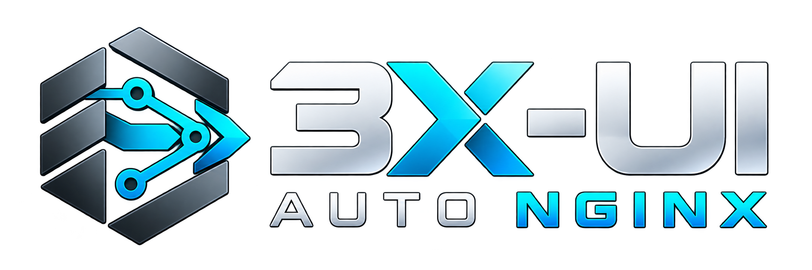
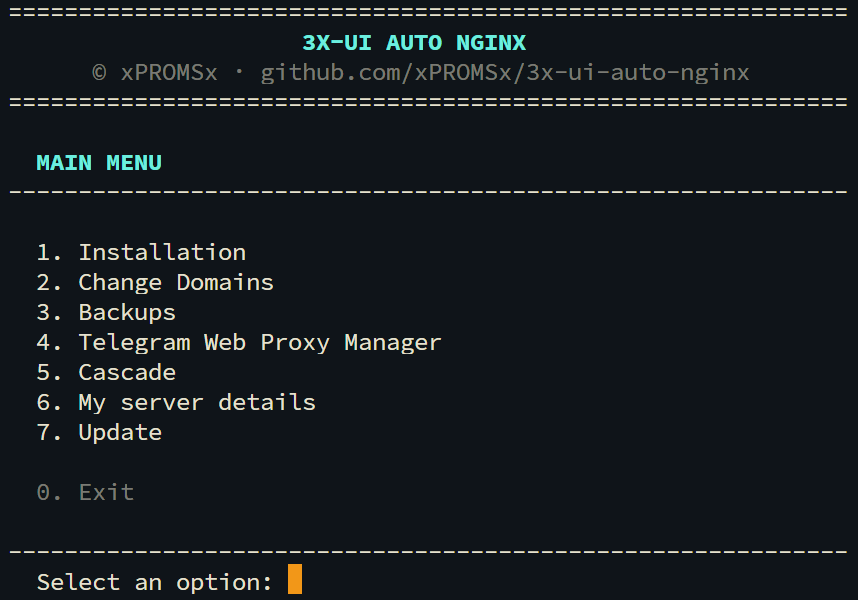

<div align="center">

[🇷🇺 Русский](README.md) · [🇬🇧 English](README_EN.md) · [🇪🇬 العربية](README_AR.md) · [🇮🇷 فارسی](README_FA.md) · [🇨🇳 简体中文](README_ZH_CN.md) · 🇪🇸 **Español** · [🇹🇷 Türkçe](README_TR.md)

<h1 align="center"></h1>

### Despliegue automático de 3X-UI / XRAY-CORE en tu propio VPS

**REALITY · XHTTP · HYSTERIA2 · CASCADE · ADGUARD HOME · UPDATE · BACKUP / RESTORE**

Dos dominios, un VPS limpio y unos minutos para completar la instalación.

[](https://github.com/xPROMSx/3x-ui-auto-nginx/releases)
[](https://github.com/xPROMSx/3x-ui-auto-nginx/releases)
[](#technical-details)
[](#technical-details)
[](docs/SUPPORT_ES.md)

[📦 Versiones](https://github.com/xPROMSx/3x-ui-auto-nginx/releases) · [🔗 Cascada](#cascade) · [🌐 Sitios de camuflaje](#cover-sites) · [✈️ Telegram Web Proxy Manager](#telemt-web-manager) · [❤️ Apoyar](#support-development) · [💬 Contacto](https://t.me/promsdev) · [🔄 Actualizar](#installation-vs-update)

[📚 Sitio de documentación (en ruso)](https://xpromsx.github.io/3x-ui-auto-nginx/)

</div>

**3X-UI AUTO NGINX** es un instalador gratuito de [3x-ui](https://github.com/MHSanaei/3x-ui) y Xray para tu VPS. Solo necesitas indicar dos dominios y ejecutar un comando. El script configura Nginx, los certificados HTTPS, las conexiones REALITY, XHTTP y Hysteria2, un enlace de suscripción y un sitio de camuflaje. El menú permite cambiar dominios, administrar copias, conectar dos servidores en cascada y configurar un DNS privado. Las instalaciones compatibles ya pueden actualizarse sin reinstalar el servidor.

**Un sitio completo en lugar de una página vacía.** Cada instalación crea sitios multipágina con navegación, artículos e imágenes. Hay al menos 2592 variantes. Las solicitudes HTTP/3 no autenticadas de Hysteria2 reciben el mismo sitio. Todo funciona con Nginx y Xray, sin Docker ni servidores web adicionales.

## ✨ ¿Por qué elegir este proyecto?

| | |
| --- | --- |
| **Listo en minutos**<br>Dos dominios, un VPS limpio y un comando. REALITY, XHTTP y Hysteria2 quedan configurados, con la dirección del panel y el enlace de suscripción. | **Parece un sitio normal**<br>Camuflaje multipágina con navegación, artículos e ilustraciones, 2592 variantes como mínimo y cobertura HTTP/3 de Hysteria2. |
| **Cascada entre dos servidores**<br>Tus dispositivos se conectan al servidor de entrada y salen a internet por el de salida, por ejemplo en otro país. Todo se configura desde el menú. | **DNS privado sin publicidad**<br>AdGuard Home bloquea anuncios y rastreadores. Los dispositivos se conectan mediante DNS-over-HTTPS (DoH) o DNS-over-TLS (DoT) opcional. |
| **Actualizaciones y copias**<br>Actualiza instalaciones compatibles desde v3.0.0 sin reinstalar. Backup v3 recupera todo el entorno administrado; también puedes migrar únicamente clientes y suscripciones a una instalación nueva. | **Seguridad sencilla**<br>El panel y las suscripciones usan HTTPS, los puertos internos permanecen locales y los certificados se renuevan solos. Protección SSH y actualizaciones de seguridad opcionales. |

**Solo lo esencial por defecto.** Las tres conexiones principales se instalan automáticamente. WebSocket, Trojan gRPC, XTLS Vision, AmneziaWG y XHTTP para CDN se crean únicamente si los eliges. No hace falta Docker.

<a id="installation"></a>

## 🚀 Inicio rápido

Utiliza un VPS limpio con Ubuntu 24.04, Ubuntu 26.04 o Debian 13 y acceso SSH como **root**. Configura dos dominios con DNS apuntando a la IP del VPS: uno para el panel y otro para REALITY. Deben estar disponibles los puertos TCP **80** y **443**, y UDP **443**. Si activas DoT, también necesitas TCP **853**. Consulta los [detalles técnicos](#technical-details).

¿Ya tienes el proyecto instalado? Lee [Actualizar el proyecto](#installation-vs-update) antes de seleccionar Installation.

```bash
curl -fSL https://github.com/xPROMSx/3x-ui-auto-nginx/releases/latest/download/x-ui-latest.sh -o x-ui-latest.sh && bash x-ui-latest.sh
```

Al ejecutar el script, elige **1 — English** o **2 — Русский**. Después se abrirá el menú principal:

<p align="center">
  
</p>

- **1 — Installation:** configurar un servidor nuevo o realizar una reinstalación completa.
- **2 — Change Domains:** cambiar el dominio del panel, de REALITY o ambos sin reinstalar.
- **3 — Backups:** Crear, consultar y restaurar copias, o recuperar solo clientes y suscripciones.
- **4 — Telegram Web Proxy Manager:** abrir o instalar el gestor independiente del proxy de Telegram.
- **5 — Cascade:** conectar dos servidores, consultar el estado o desconectarlos.
- **6 - My server details:** muestra las direcciones del panel, las suscripciones y AdGuard Home, además de los nombres de usuario. No cambia nada ni revela contraseñas.
- **7 — Update:** Actualizar una instalación compatible sin reinstalar, conservando clientes y ajustes.
- **0 — Exit:** salir.

El menú requiere una sesión SSH con terminal interactiva.

<details>
<summary><strong>Descarga alternativa — si GitHub Releases no está disponible</strong></summary>

**La rama `main` contiene una versión alfa del proyecto.** No se recomienda instalarla. Utiliza la versión estable con el comando principal de arriba.

```bash
curl -fSL https://raw.githubusercontent.com/xPROMSx/3x-ui-auto-nginx/main/x-ui-latest.sh -o x-ui-latest.sh && bash x-ui-latest.sh
```

</details>

<a id="installation-vs-update"></a>

### Actualizar el proyecto

**Instalaciones compatibles desde v3.0.0:** descarga el gestor estable actual con el comando anterior, selecciona **7 — Update** y confirma. El gestor comprueba la compatibilidad, crea y verifica un Backup v3 antes de modificar nada, actualiza la configuración administrada por el proyecto y, si es necesario, 3x-ui y Xray a las versiones verificadas. Se conservan los clientes, suscripciones, claves, ajustes del panel, cascada y reglas de enrutamiento.

`SUCCESS` indica que la actualización ha terminado; `UP TO DATE` indica que no hacía falta actualizar. Comprueba el panel y la conexión de un cliente, y guarda la nueva copia fuera del VPS si se creó. Las conexiones pueden interrumpirse brevemente, los sitios de camuflaje administrados pueden regenerarse y las modificaciones manuales de Nginx o del transporte administrados pueden sustituirse. Actualiza los perfiles de cliente si es necesario.

Update requiere una instalación compatible (`update_contract=1`) y no añade opciones de instalación que no seleccionaste. Si 3x-ui o Xray es más reciente que la versión verificada, Update rechaza instalar una versión anterior. Si falla, revisa el error y el resultado de la reversión. Si aparece `ROLLBACK UNVERIFIED`, detente y conserva la copia y los archivos de recuperación; no reinstales.

**Migración desde 2.x a v3.0.0 o posterior, o instalación nueva con una configuración limpia:**

1. Crea un Backup v3 y descárgalo fuera del VPS. Guarda por separado las conexiones de salida personalizadas, reglas de enrutamiento y otros ajustes.
2. Instala la nueva versión en el VPS actual o en uno nuevo. Usa el dominio anterior del panel para conservar las URL de suscripción y omite la creación automática del cliente.
3. Selecciona **3 — Backups → 4 — Restore clients and subscriptions** y elige el archivo.
4. Vuelve a aplicar tus ajustes personalizados, actualiza las suscripciones y prueba las conexiones.

Restore completo recupera la configuración archivada; no actualiza el proyecto.

> [!CAUTION]
> **¡Instalar no significa actualizar!**
>
> Volver a ejecutar el script **sin parámetros** abre el gestor, pero no reinstala el servidor. Sin embargo, **Installation** sirve para un VPS limpio o una reinstalación completa.
>
> Si detecta una instalación existente, el script advierte de que eliminará los datos gestionados y solicita escribir **YES** exactamente. La reinstalación sustituye la base de datos de 3X-UI y la configuración de nginx. Además:
> - si antes tenías XTLS Vision y ahora no lo seleccionas (o eliges otro dominio), elimina el certificado del antiguo dominio Vision creado por el instalador. Avisará de ello antes de pedir YES;
> - si antes tenías AmneziaWG y ahora no lo seleccionas, se cierra el puerto 8443/udp (sin aviso independiente).
>
> **Guarda antes una copia de Backup fuera del VPS.**
>
> **Change Domains** y **Backups** son operaciones independientes que no reinstalan el panel.

Usa Update del proyecto para obtener las versiones verificadas de 3x-ui y Xray. Actualizarlos por separado desde el panel puede impedir Update hasta que haya una versión compatible. Actualiza nginx, el núcleo de Linux y los demás paquetes por separado con las herramientas del sistema operativo. Para usar solo nuevas funciones del gestor, descárgalo de nuevo.

Hay siete preguntas principales de instalación, algunas con opciones adicionales. Los valores predeterminados sirven para la mayoría de los usuarios.

| Nº | Pregunta | Predeterminado | Función |
| --- | --- | :---: | --- |
| 1 | Dominio del panel | - | Panel, suscripciones y sitio de camuflaje |
| 2 | Dominio REALITY | - | REALITY y sitio de camuflaje |
| 3 | Seguridad avanzada del VPS | `Y` | Fail2ban, DNS cifrado del propio VPS y actualizaciones |
| 4 | Conexiones adicionales (se eligen por separado) | `N` | WebSocket, Trojan gRPC, XTLS Vision, AmneziaWG y XHTTP para CDN |
| 5 | Sitios rusos mediante WARP | `N` (inglés), `Y` (ruso) | Ocultar la IP del VPS |
| 6 | AdGuard Home | `N` | DNS privado con DoH y DoT opcional |
| 7 | Cliente y suscripción | `Y` | Enlace de suscripción al finalizar |

Las preguntas 4.1 a 4.4 solo aparecen si habilitas las conexiones adicionales.

---

### 1. 🌐 Dominio del panel 3X-UI

> `Enter the domain for your 3X-UI panel:`

Indica el dominio de acceso al panel de administración, las suscripciones y los servicios web adicionales.

---

### 2. 🛰️ Dominio de VLESS REALITY

> `Enter the domain for VLESS REALITY:`

Indica un segundo dominio para REALITY. Los registros DNS de ambos dominios deben apuntar a la IP de tu VPS.

<details>
<summary>ℹ️ Parámetros adicionales de ejecución</summary>

Puedes indicar ambos dominios directamente, sin introducirlos de forma interactiva:

```bash
bash x-ui-latest.sh -subdomain panel.example.com -reality_domain reality.example.com
```

Sustituye `panel.example.com` y `reality.example.com` por tus propios dominios. Las funciones opcionales se seguirán eligiendo de forma interactiva.

</details>

---

### 3. 🔐 Seguridad avanzada del VPS

> `Enhance VPS security? [Y/n]:`

*Recomendado para usuarios con poca experiencia · Activado por defecto (`Y`)*

El instalador configura Fail2ban para proteger SSH, DNS cifrado del sistema (DoT) y actualizaciones de seguridad automáticas. Si se cumplen las condiciones, también crea un archivo swap de 1 GiB, independientemente de la opción de seguridad avanzada.

**Lee los detalles siguientes antes de activar esta opción**, especialmente el horario de reinicios automáticos.

<details>
<summary>🔐 Descripción detallada de los ajustes de seguridad</summary>

Al elegir `Y` se activan las opciones de seguridad adicionales. La configuración del swap es independiente de esta elección:

- **Swap de 1 GiB.** Si no hay swap activo, el sistema de archivos es compatible y hay al menos 4 GiB libres, el instalador crea y activa un archivo swap. Los ajustes de swap existentes no cambian. Si no se cumplen estas condiciones, se omite este paso sin detener la instalación.
- **Protección SSH — Fail2ban.** Limita los intentos de acceso fallidos en los puertos SSH reales. No modifica los ajustes existentes de autenticación SSH. Se conserva la jail de SSH existente si funciona correctamente y es compatible.
- **DNS cifrado (DoT).** Los resolutores globales de Cloudflare y Google usan DNS-over-TLS estricto mediante `systemd-resolved`. Se conservan las rutas DNS y los dominios de búsqueda de las interfaces/VPN; sus consultas pueden seguir sin cifrar. Si falla la preparación de DoT y se restaura correctamente el DNS original, la instalación principal, Fail2ban y las actualizaciones automáticas continúan de forma independiente de DoT; el resultado final informa del fallo y devuelve un código distinto de cero.
- **Actualizaciones de seguridad automáticas.** Las listas de paquetes se actualizan a las 02:30 y las actualizaciones se instalan a las 02:50.
- **Reinicio automático — 04:38.** Si una actualización requiere reiniciar, el servidor lo hará a esa hora, **incluso con sesiones de usuario activas**, lo que puede interrumpir las conexiones.

Los horarios corresponden a la zona horaria local del VPS.

Se comprueba la compatibilidad de los ajustes existentes antes de modificarlos. Si falla la configuración de seguridad, se realiza una reversión controlada.

**Importante:** esta opción no desactiva el acceso SSH mediante contraseña ni sustituye la administración del servidor. Configura primero el acceso con claves SSH y después desactiva manualmente la autenticación por contraseña.

</details>

---

### 4. 🧩 Conexiones adicionales

> `Set up additional connections? [y/N]:`

*Desactivadas por defecto (`N`)*

REALITY, XHTTP y Hysteria2 se configuran automáticamente. Puedes añadir WebSocket, Trojan gRPC, XTLS Vision, AmneziaWG y XHTTP para CDN por separado.

> [!WARNING]
> Estas conexiones pueden no funcionar en todos los países o proveedores. Úsalas bajo tu responsabilidad. Si tienes dudas, responde `N`.

Si respondes `N`, no se crea ninguna conexión adicional y se omiten las preguntas 4.1 a 4.4. Si respondes `y`, podrás elegir cada tipo por separado.

#### 4.1. WebSocket y Trojan gRPC

> `Set up legacy VLESS WebSocket and Trojan gRPC connections? [y/N]:`

Con `y` se crean las dos conexiones activadas. Con `N` no se crea ninguna.

---

<a id="4--vless-xtls-vision"></a>

#### 4.2. 🔗 VLESS XTLS Vision

> `Set up an additional VLESS TCP/TLS (XTLS Vision) connection? (requires a separate domain) [y/N]:`

*Conexión adicional · Desactivada por defecto (`N`)*

Una conexión VLESS alternativa mediante TLS que puede ser útil si REALITY funciona de forma inestable o está bloqueado en tu red. Se crea como un perfil independiente en 3X-UI.

> [!IMPORTANT]
> **XTLS Vision necesita un tercer dominio**, distinto de los usados para el panel y REALITY. Su registro DNS debe apuntar a la IP del VPS. El certificado HTTPS y el enrutamiento nginx se configuran automáticamente.
>
> Si respondes `Y`, el instalador también solicitará este dominio: `Enter the domain for VLESS TLS Vision (must differ from the panel and REALITY domains):`.

---

<a id="5--amnezia-wg"></a>

#### 4.3. 🔑 Amnezia WG

> `Set up an additional AmneziaWG connection? [y/N]:`

*Conexión adicional · Desactivada por defecto (`N`)*

Se crea una conexión AmneziaWG independiente en el panel 3X-UI. No es necesario otro dominio.

<details>
<summary>ℹ️ Más información sobre Amnezia WG</summary>

El instalador configura AmneziaWG 3.1 en **UDP/8443** y añade automáticamente la regla necesaria de UFW.

Después, crea un cliente en el panel 3X-UI para obtener una configuración o un enlace `vpn://` para una aplicación Amnezia compatible.

El instalador crea la conexión del servidor, pero no genera clientes AmneziaWG automáticamente.

La configuración y la regla del cortafuegos están incluidas en **Backup / Restore v3**.

</details>

---

<a id="xhttp-cdn"></a>

#### 4.4. 🌐 VLESS + XHTTP para CDN

> `Add an additional CDN-compatible XHTTP connection? [y/N]:`

Por defecto se activa el cifrado adicional VLESS ML-KEM-768 native entre el cliente y Xray, compatible con Vision. El núcleo del cliente debe admitir VLESS Encryption; se puede desactivar en el panel.

*Conexión adicional · No se instala por defecto (`N`)*

Se crea una conexión VLESS independiente con transporte XHTTP en modo packet-up, preparada para usarla a través de una CDN. La conexión se crea desactivada en 3X-UI.

Se utiliza el dominio HTTPS existente del panel, sin necesidad de otro dominio ni certificado. Una vez activada, la conexión también se puede usar directamente, sin CDN.

Para utilizar una CDN, debes configurar tu proveedor y ajustar los parámetros de Host en 3X-UI. El instalador no configura servicios CDN; proporciona un perfil de servidor listo para adaptarlo a tus necesidades.

---

<a id="warp-ru"></a>

### 5. 🌐 Sitios rusos a través de Cloudflare WARP

> `Route Russian websites through Cloudflare WARP to hide your VPS IP? [y/N]:`

*Enrutamiento opcional · Activado por defecto en el menú ruso (`Y`) y desactivado en el inglés (`N`)*

Si vas a usar este VPS como servidor de entrada de una cascada, elige `N`. WARP no es compatible con el servidor de entrada, pero sí puede usarse en el de salida.

Al elegir `Y`, el instalador configura Cloudflare WARP (MASQUE) para que los sitios web rusos y determinados servicios de red vean una dirección IP de Cloudflare en lugar de la IP de tu VPS. Esto es necesario para proteger la IP de tu VPS.

Esta configuración solo afecta al tráfico que pasa por el VPS. Si una aplicación se conecta directamente a un sitio, WARP en el servidor no interviene.

Al activar la función, el instalador registra un dispositivo en Cloudflare y acepta sus condiciones de servicio.

Si falla la configuración de WARP, la instalación continuará sin él y el informe final indicará un resultado parcial. Si no se puede verificar la reversión de los cambios, comprueba el funcionamiento de Xray en el panel.

<details>
<summary>ℹ️ <strong>Qué sitios usan WARP y cómo comprobar la configuración</strong></summary>

El instalador añade una salida llamada `warp-masque` y tres reglas de enrutamiento a la configuración de Xray:

- **WARP - RU:** dominios rusos de `geosite:category-ru`.
- **WARP - RU2:** direcciones IP de `geoip:ru`.
- **WARP - RU3:** `ipify.org`, `ifconfig.me`, `checkip.amazonaws.com`, `ipapi.is`, `iplocate.io`, `ip.sb` y `2gis.com`.

Las reglas se añaden al final de la lista. Las reglas anteriores conservan su prioridad. No es un perfil de conexión independiente para el cliente ni una VPN de todo el sistema: el enrutamiento se realiza dentro de Xray.

Después de instalar, comprueba `warp-masque` en **Xray → Outbounds** y las tres reglas anteriores en **Xray → Routing**, dentro del panel 3X-UI. Los ajustes se guardan en Backup v3 junto con la configuración de 3X-UI.

</details>

---

<a id="7--adguard-home--dns-over-https"></a>
<a id="6--adguard-home--dns-over-https"></a>

### 6. 🛡️ AdGuard Home + DNS-over-HTTPS y DNS-over-TLS

> `Install and configure AdGuard Home? [y/N]:`

*Servidor DNS adicional · Desactivado por defecto (`N`)*

Tu propio DNS para bloquear anuncios y rastreadores, administrar clientes y cifrar consultas. Los dispositivos pueden utilizar DoH o DoT opcional (por ejemplo, «DNS privado» de Android).

<details>
<summary>ℹ️ <strong>AdGuard Home y control de acceso</strong></summary>

No hace falta un dominio adicional.

Tras la instalación tendrás:

- **Panel de AdGuard Home:** `https://panel.example.com/adg-.../`, con una ruta aleatoria propia.
- **DNS-over-HTTPS:** `https://panel.example.com/dns-XXXXXXXXXXXX`. El segmento `dns-XXXXXXXXXXXX` se genera aleatoriamente en cada instalación.
- **DNS-over-TLS** (si lo eliges): `panel.example.com`, puerto 853.

Estas direcciones aparecen al terminar la instalación y después en **6 - My server details**. No podrás recuperar ahí la contraseña de AdGuard Home: guárdala al instalar.

No se abren los puertos públicos **53** TCP y UDP. Para AdGuard Home solo se abre el puerto adicional **853** si activas DoT. La configuración y los datos se incluyen en **Backup / Restore v3**. Los servidores instalados antes de 2.7.0 conservan la dirección `https://panel.example.com/dns-query`.

**Uso de DoH y ClientID opcional**

AdGuard Home es independiente del DNS del sistema del VPS. Instalarlo no hace que el VPS, Xray o las aplicaciones cliente lo utilicen automáticamente. Configura el DNS en el dispositivo o aplicación que quieras utilizar y comprueba el registro de consultas de AdGuard Home.

La ruta DoH aleatoria basta para uso personal si no hay una lista de clientes permitidos configurada. Mantén la URL en privado: una ruta aleatoria es más difícil de adivinar, pero no es autenticación.

`https://panel.example.com/dns-XXXXXXXXXXXX`

El [ClientID](https://adguard-dns.io/kb/adguard-home/clients/#clientid) es opcional. Ayuda a identificar dispositivos, asignar reglas individuales y restringir el acceso, especialmente en instalaciones antiguas con la ruta predecible `/dns-query`. Crea clientes persistentes con identificadores aleatorios largos y añádelos en **Settings → DNS settings → Access settings → Allowed clients** si quieres restringir el acceso. Conserva las demás entradas necesarias.

`https://panel.example.com/dns-XXXXXXXXXXXX/<ClientID>`

Al activar la lista, se rechazan las consultas que no coincidan con un identificador u otra entrada permitida. Consulta la [guía oficial de seguridad de AdGuard Home](https://adguard-dns.io/kb/adguard-home/running-securely/).

**DoT y clientes permitidos:** DoT no transmite ClientID. Si activas la lista y usas DoT, añade `127.0.0.1`; de lo contrario DoT deja de responder. Esto permite usar DoT a cualquiera que conozca la dirección del servidor.

**Ejemplo con Happ (suscripción RAW):** en el perfil de enrutamiento activo, selecciona DoH para Remote DNS, introduce la URL completa en Remote DNS Domain y la IP pública del VPS en Remote DNS IP. Guarda, vuelve a conectar y revisa el registro de consultas. En las suscripciones JSON, el DNS de Xray puede venir definido en el propio JSON; Tunnel DNS es un ajuste independiente.

AdGuard Home puede actualizarse desde la interfaz web en instalaciones a partir de v2.4.1. Para instalaciones anteriores, consulta las [instrucciones de activación antiguas (en ruso)](docs/ADGUARD_UPDATES.md).

</details>

#### 6.1. DNS-over-TLS (DoT)

> `Enable DNS-over-TLS (DoT) for your devices? [y/N]:`

DoT se utiliza sobre todo con «DNS privado» de Android, que solo admite un nombre de host. Si no lo necesitas, deja `N`.

- Disponible solo en instalaciones nuevas junto con AdGuard Home.
- DoT recibe consultas en `panel.example.com`, puerto **853**. Se añade automáticamente la regla UFW y se utiliza el certificado del dominio del panel.
- **El puerto 853 está abierto a todo internet.** DoT no transmite ClientID; cualquiera que conozca la dirección puede conectarse. Las conexiones simultáneas se limitan a unas 50 por IP de origen.
- En los registros de AdGuard Home, las consultas DoT aparecen como `127.0.0.1`, porque Nginx las reenvía localmente. No se pueden distinguir los dispositivos DoT.
- Si hay una lista de clientes permitidos, añade `127.0.0.1` para que DoT siga funcionando; consulta la explicación de ClientID anterior.
- Los ajustes de DoT se incluyen en Backup / Restore v3 y se tienen en cuenta al cambiar dominios.

**Cómo conectar Android.** En Ajustes busca «DNS privado», elige el modo de nombre de host e introduce el dominio del panel.

**Cómo desactivar DoT.** Ejecuta este comando como root en el servidor:

```bash
ufw delete allow 853/tcp
```

El puerto 853 se cerrará y los demás servicios seguirán funcionando. Para eliminar DoT por completo hay que reinstalar el servidor.

---

<a id="7--creación-automática-del-cliente-y-la-suscripción"></a>

<a id="8--creación-automática-del-cliente-y-la-suscripción"></a>

### 7. 👤 Creación automática del cliente y la suscripción

> `Create a client in 3X-UI and display a subscription link after installation? [Y/n]:`

*Recomendado · Activado por defecto (`Y`)*

El instalador crea un cliente en 3X-UI y genera una URL de suscripción HTTPS personal para las conexiones configuradas y compatibles.

El enlace aparecerá en el informe final. Si rechazas esta opción, podrás crear clientes manualmente desde el panel.

---

Al terminar se mostrarán **la URL del panel, el usuario y la contraseña, la URL de diagnóstico y el enlace de suscripción** (si elegiste crear un cliente). Si instalaste AdGuard Home, también verás la dirección de administración, la contraseña y el endpoint DoH. También se muestra el resultado de la configuración de WARP.

Si una actualización del sistema operativo requiere reiniciar, el instalador lo indicará. **El primer reinicio es manual**: ejecuta `sudo reboot`.

<a id="cover-sites"></a>

## 🌐 Sitios de camuflaje y HTTP/3

**Sitios web completos en lugar de páginas de relleno.** Cada instalación nueva crea automáticamente sitios multipágina distintos para el panel y REALITY. Hay al menos 2592 combinaciones preparadas de diseño y textos, con navegación funcional, ilustraciones y diseño adaptable a móviles. XTLS Vision, si se activa, recibe su propio sitio.

**Cada instalación tiene su propia apariencia.** Los nombres, colores, imágenes, iconos y textos se personalizan automáticamente. Las páginas adicionales contienen distintos artículos y fechas de publicación. El diseño elegido se conserva al realizar Backup/Restore y al cambiar dominios. Durante Update, los sitios de camuflaje administrados pueden regenerarse.

**Hysteria2 con camuflaje HTTP/3.** Las solicitudes HTTPS normales por TCP y las solicitudes HTTP/3 no autenticadas por UDP en el dominio de REALITY muestran el mismo sitio completo. El panel y las suscripciones permanecen aislados del camuflaje HTTP/3 público.

**Protección contra el exceso de solicitudes HTTP.** Nginx limita los sitios de camuflaje públicos a 20 solicitudes por segundo por IP y sitio, y 200 por segundo en total por sitio, con ráfagas permitidas. Las solicitudes excedentes reciben HTTP 429 con una página de error acorde al sitio. Estos límites no afectan a las conexiones proxy, el panel, las suscripciones, AdGuard Home ni Telegram WEB Proxy. No sustituyen la protección contra DDoS.

## 🚀 Perfiles de conexión

| Conexión | Cuándo se crea |
| --- | :---: |
| VLESS + REALITY | ✅ Siempre, activada |
| VLESS + XHTTP | ✅ Siempre, activada |
| Hysteria2 | ✅ Siempre, activada |
| VLESS + WebSocket (TLS) | 🔧 Opcional, activada si se elige |
| Trojan + gRPC | 🔧 Opcional, activada si se elige |
| VLESS + XTLS Vision | 🔧 Opcional, necesita tercer dominio |
| Amnezia WG | 🔧 Opcional |
| VLESS + XHTTP para CDN | 🔧 Opcional, creada desactivada |

REALITY, XHTTP y Hysteria2 funcionan inmediatamente después de instalar. Las demás conexiones solo se crean si respondes `y` a la pregunta sobre conexiones adicionales (paso 4). Las que no elijas no se crean.

XHTTP para CDN se crea desactivada y no aparece en las suscripciones hasta que la actives y asocies un cliente. En los servidores instalados antes de 2.7.0, WebSocket y Trojan gRPC siguen existiendo, desactivados como antes.

Puedes crear clientes durante la instalación o después desde el panel. AmneziaWG necesita un cliente aparte. La compatibilidad depende de la aplicación cliente y su versión; XHTTP para CDN también depende del proveedor.

### Suscripciones

Las suscripciones estándar, JSON y **Mihomo / Clash** se sirven mediante nginx y HTTPS. `provider=1` devuelve la suscripción original para los proveedores de proxy en lugar de una configuración completa de Clash.


<a id="change-domains"></a>

## 🌐 Cambiar dominios

En el menú principal, selecciona **2 — Change Domains**. Puedes cambiar el dominio del panel, el de REALITY o ambos sin reinstalar. Los nuevos registros DNS deben apuntar al VPS; el puerto TCP/80 debe estar accesible para emitir los certificados. Los dominios deben ser diferentes entre sí y del dominio de Vision.

Antes de los cambios se crea automáticamente un Backup v3 completo. Se conservan clientes, claves, ajustes y estadísticas de tráfico. El dominio de Vision no cambia. Después, puede que tengas que actualizar las URL de suscripción y la configuración de los clientes.

Solo se admiten instalaciones del proyecto que puedan reconocerse, incluidas las instalaciones v2.1.7 compatibles. Si ocurre un error, **no elimines las copias ni los datos de recuperación**. Si aparece `ROLLBACK_UNVERIFIED`, detente y conserva los datos de diagnóstico. [Detalles, limitaciones y recuperación](docs/MANAGER.md#change-domains).

## 💾 Copias de seguridad y restauración

En el menú principal, abre **3 — Backups** para crear copias, consultar los archivos disponibles o restaurarlos. Puedes utilizar una copia después de reinstalar el sistema operativo o al cambiar de VPS. Para restaurarla, deben coincidir el sistema operativo, su versión y la arquitectura del procesador.

Backup v3 completo recupera el entorno administrado archivado, mientras que **Restore clients and subscriptions** transfiere únicamente los datos de usuarios a una instalación nueva. Utiliza [Update](#installation-vs-update) para las instalaciones compatibles. El gestor actual admite Backup v3; los archivos v2 requieren la herramienta de la versión anterior correspondiente. Los datos de TWPM se administran por separado y Restore completo se bloquea si TWPM está instalado en el VPS de destino.

En un VPS nuevo, Restore desde el menú espera a que termine la actualización automática del sistema (hasta 60 minutos). No reinicies el servidor durante ese tiempo.

También puedes utilizar estos comandos como root:

**Antes de restaurar:** el comando de restauración sustituye los datos administrados. A diferencia del menú, no activa UFW ni configura los ajustes adicionales de Security. Sustituye `ARCHIVE.tar.gz` por el nombre de tu copia de confianza.

```bash
# Crear una copia de seguridad
x-ui-backup backup

# Mostrar las copias disponibles
x-ui-backup list

# Restaurar una copia concreta
x-ui-backup restore /var/backups/x-ui/ARCHIVE.tar.gz
```

Los archivos se guardan en `/var/backups/x-ui/`.

> **Las copias contienen información sensible:** base de datos de clientes, contraseñas y claves privadas de certificados. Conserva una copia **fuera del VPS** y restaura únicamente archivos de confianza.

Si Restore no está disponible, extrae los archivos para una recuperación manual sin instalar paquetes ni iniciar servicios. Necesitas Bash, Python 3 y acceso al archivo y al destino; no hace falta root:

```bash
x-ui-backup extract /path/to/archive.tar.gz ./recovered-backup
```

El directorio de destino debe ser nuevo; las rutas originales se conservan dentro de `files/` y se omiten los enlaces. Los datos contienen secretos: revísalos antes de copiar nada sobre un servidor en funcionamiento.

[Restauración en un VPS nuevo](#restore-on-new-vps).

<a id="restore-clients"></a>

### Restaurar clientes y suscripciones

Tras instalar el proyecto en un VPS nuevo o reinstalado, abre **3 — Backups → 4 — Restore clients and subscriptions**. Selecciona un archivo normal de Backup v3 por su número o introduce la ruta absoluta. Introduce las credenciales del panel nuevo y el código 2FA si está activo. Se importan los datos de usuarios en la instalación actual sin sustituir todo el entorno.

Del archivo se recuperan identificadores, credenciales, estado, límites, caducidad, contadores compatibles y rutas compartidas RAW y JSON. Los clientes reciben todas las conexiones locales activas compatibles. El dominio, los certificados, la configuración de las conexiones y el resto de la infraestructura proceden de la instalación actual. El panel asigna las direcciones de AmneziaWG desde la subred actual. No se importan las conexiones de entrada personalizadas, las asignaciones individuales de clientes, las conexiones de salida, las reglas de enrutamiento, los balanceadores ni otros ajustes del servidor; vuelve a crear los que necesites.

Las URL de suscripción anteriores siguen siendo válidas tras una importación correcta si conservas el dominio del panel y los tipos de suscripción correspondientes. Si cambia la IP, apunta el dominio al nuevo VPS mediante DNS. Los enlaces emitidos por la instalación nueva con rutas distintas pueden dejar de funcionar. Actualiza las suscripciones para cargar la nueva configuración; los enlaces de conexiones individuales pueden cambiar.

Si coincide el correo o el identificador de suscripción, se conserva el registro existente y se omite el cliente del archivo. También se omiten los identificadores vacíos o compartidos por varios registros del archivo. `PARTIAL` indica que se aplicaron las rutas y hubo clientes omitidos, registros incompletos o comprobaciones sin confirmar. Revisa clientes, límites, caducidad y conexiones en 3x-ui.

<a id="cascade"></a>

## 🔗 Cascada entre dos servidores

La cascada conecta dos VPS con 3X-UI AUTO NGINX: tus dispositivos se conectan al servidor de entrada y acceden a internet a través del servidor de salida. Puede ser útil si tienes problemas para conectarte a un VPS o necesitas salir a internet a través de un servidor en otro país.

**Dispositivo → VPS de entrada → VPS de salida → Internet**

Los sitios web rusos y las direcciones IP rusas se abren directamente desde el servidor de entrada. Después de configurar la cascada, puedes desactivar este comportamiento en las reglas de enrutamiento del VPS de entrada. El tráfico que no coincida con reglas anteriores pasa por el servidor de salida.

La configuración se realiza desde **5 — Cascade** en el menú principal, sin editar archivos manualmente.

<details>
<summary><strong>Cómo configurar la cascada, comprobar el estado y desconectarla</strong></summary>

### Qué necesitas

- Dos VPS con instalaciones operativas de 3X-UI AUTO NGINX.
- El usuario y la contraseña del panel 3X-UI de cada servidor.
- El instalador actual con la opción **5 — Cascade**.
- No debe haber WARP configurado en el servidor de entrada (puedes quitarlo manualmente).

### 1. Crear la clave en el servidor de salida

Ejecuta el instalador actual en el VPS que usarás para acceder a internet.

Selecciona **5 — Cascade → 1 — Create key (exit server)**.

Introduce el usuario y la contraseña del panel 3X-UI. Se escriben de forma oculta y no se guardan. El gestor crea un cliente llamado `cascade` en la conexión REALITY existente y muestra un enlace de clave que empieza por `vless://`.

Copia ese enlace. Lo necesitarás en el segundo servidor.

**No publiques el enlace de clave:** permite conectarse con ese cliente.

Los clientes existentes no se modifican.

### 2. Conectar el servidor de entrada

Ejecuta el instalador actual en el VPS al que se conectan tus dispositivos.

Selecciona **5 — Cascade → 2 — Connect exit server (entry server)**.

Introduce el usuario y la contraseña del panel 3X-UI (tampoco se guardan) y pega el enlace de la primera etapa. Al pegarlo, el enlace se ve en la terminal, pero no se guarda.

El gestor prueba primero la conexión con el servidor de salida. Si funciona, añade una conexión de salida `cascade-exit` y tres reglas de enrutamiento `CASCADE`.

Los sitios y las IP de Rusia se abren directamente desde el servidor de entrada, salvo que desactives esas reglas después. El resto del tráfico correspondiente pasa por el servidor de salida.

**Al aplicar los cambios, las conexiones de todos los usuarios pueden interrumpirse unos segundos.** Si una comprobación falla, el gestor intenta recuperar la configuración anterior e informa del resultado.

Los clientes y las suscripciones existentes siguen utilizándose. No hace falta crear perfiles exclusivos para la cascada.

### 3. Comprobar el estado

En cada VPS, abre **5 — Cascade → 3 — Status**.

El gestor pedirá el usuario y la contraseña del panel, como en las demás operaciones.

Mostrará si están configurados los roles de entrada y salida en ese servidor y si Xray está funcionando. La comprobación no cambia ajustes.

### 4. Desconectar la cascada

En el VPS correspondiente, abre **5 — Cascade → 4 — Disable**.

**En el servidor de entrada**, el gestor propone eliminar `cascade-exit` y las tres reglas `CASCADE`. Las demás conexiones y reglas del panel se conservan.

**En el servidor de salida**, solo se elimina el cliente `cascade`. Los servidores de entrada que usan su clave ya no podrán enviar tráfico por esa salida.

Cada eliminación requiere una confirmación independiente. Al aplicar los cambios en el servidor de entrada, las conexiones pueden interrumpirse brevemente.

### Qué debes saber

- **WARP:** no es compatible con el servidor de entrada. Si está configurado, elimina su conexión de salida y sus reglas desde el panel 3X-UI antes de conectar. En el servidor de salida sí se permite.
- **AmneziaWG:** estas conexiones no pasan por el servidor de salida.
- **Reglas de enrutamiento:** las reglas anteriores pueden enviar parte del tráfico por otra ruta. El gestor te avisará antes de conectar.
- **Salida no disponible:** el tráfico encaminado por ella dejará de funcionar hasta que vuelva a estar disponible, salvo que hayas configurado un balanceador con una salida de reserva.
- **QUIC por Vision:** UDP/443 no pasa por esta cascada.
- **Cambio de dominios:** si cambias los dominios del VPS de salida, deberás volver a conectarlo desde el de entrada.

### Copias de seguridad

Backup v3 guarda la configuración de la cascada. Al restaurar una copia en el servidor de entrada, se conservan sus ajustes junto con los demás datos de 3X-UI. Update también conserva la cascada; tras una instalación nueva con importación solo de clientes, vuelve a configurarla.

La cascada se ha probado en dos VPS reales con REALITY, XHTTP y Hysteria2. No se ha confirmado su compatibilidad con todas las aplicaciones cliente y configuraciones.

Si encuentras un error, [infórmalo en GitHub](https://github.com/xPROMSx/3x-ui-auto-nginx/issues).

</details>

## 🔐 Seguridad

Las interfaces de servicio no se exponen directamente a internet: el panel, las suscripciones y los servicios adicionales pasan por nginx y HTTPS y los puertos internos siguen siendo locales. El único puerto de servicio adicional es el 853, y solo si activas DNS-over-TLS (DoT). Los puertos de las conexiones de tus dispositivos están abiertos por naturaleza: TCP y UDP 443, además de UDP 8443 si eliges AmneziaWG.


**¿No sabes cómo proteger tu VPS?** Puedes activar la seguridad avanzada durante la instalación para configurar protección SSH contra ataques de fuerza bruta, DNS cifrado y actualizaciones de seguridad. Antes, consulta los detalles y el horario de reinicios nocturnos en **Inicio rápido**.

**Importante:** protege también el acceso al servidor. Usa claves SSH y comprueba que funcionan antes de desactivar la autenticación por contraseña. El instalador no la desactiva automáticamente.

<a id="telemt-web-manager"></a>

## ✈️ Telegram Web Proxy Manager

[Telegram Web Proxy Manager](https://github.com/xPROMSx/telegram-web-proxy-manager) es un proyecto independiente para crear tu propio Telegram WEB Proxy con HTTPS, un sitio de camuflaje y actualizaciones con posibilidad de reversión.

**TWPM no forma parte de la instalación básica de 3X-UI.** La opción 4 del menú principal permite abrirlo o iniciar su instalación por separado tras confirmarla. Ambos proyectos se administran de manera independiente.

Telegram Web Proxy Manager se instala en Ubuntu 24.04 y 26.04.

TWPM utiliza Telemt con HTTPS real, su propio dominio y la misma instancia de Nginx. También puedes configurar su tráfico de salida mediante SOCKS5 usando una cascada existente. Haz las copias de TWPM por separado: sus datos no están incluidos en Backup v3 del proyecto.

<a id="technical-details"></a>

## ⚙️ Detalles técnicos y compatibilidad

- **Sistemas:** Ubuntu 24.04, Ubuntu 26.04 y Debian 13.
- **UFW:** permite 80/tcp, 443/tcp y 443/udp (8443/udp al seleccionar AmneziaWG y 853/tcp al seleccionar DoT). Durante Installation, UFW solo se activa después de comprobar el acceso SSH; si no es seguro hacerlo, permanece desactivado y se muestra una advertencia. Después de Restore, el gestor puede activarlo **solo si se solicita expresamente** y se superan las comprobaciones de seguridad. El comando `x-ui-backup restore` no activa UFW.
- **Certificados:** Let's Encrypt con webroot y `certbot.timer` renuevan los certificados automáticamente sin detener nginx.
- **Seguimiento de conexiones:** el instalador, Restore y Update pueden elevar el límite conntrack de Linux según la RAM disponible cuando el sistema lo admite, sin reducir un límite superior existente.
- **Versión de 3x-ui:** el instalador usa la versión más reciente verificada para la configuración del proyecto, que puede no coincidir con la última del proyecto original. En instalaciones compatibles, usa Update para obtener las versiones verificadas de 3x-ui y Xray. Puedes actualizarlos por separado desde el panel, pero una versión más reciente puede bloquear Update. También puedes elegir otra versión estable con `-version <tag>` (mínimo v3.8.0); se mostrará una advertencia si no se ha verificado la compatibilidad.

<a id="restore-on-new-vps"></a>

### Restauración en un VPS nuevo

Utiliza un VPS limpio con la misma familia y versión del sistema operativo y arquitectura que la copia. Copia el archivo Backup v3 a un directorio privado del VPS, por ejemplo `/var/backups/x-ui/`. Si cambia la IP, apunta los dominios a la nueva.

1. Conéctate por SSH como root y descarga y ejecuta el gestor estable con el comando de [Inicio rápido](#installation).
2. Selecciona **3 — Backups → 3 — Restore backup**, no Installation. Elige el archivo y confirma.
3. Sigue las preguntas de Security y UFW. Comprueba el panel, las suscripciones, las conexiones proxy y los servicios adicionales.

No instales previamente el proyecto. Restore completo recupera la configuración archivada. El acceso SSH, el sistema operativo y otros servicios siguen siendo responsabilidad del administrador. Restore completo se bloquea si TWPM está instalado en el VPS de destino; guarda y administra sus datos por separado.

## 🤝 Créditos y origen

Este proyecto parte de [3x-ui-pro](https://github.com/mozaroc/3x-ui-pro) de mozaroc. Ese repositorio surgió de un fork de [x-ui-pro](https://github.com/mozaroc/x-ui-pro) y se remonta al [x-ui-pro](https://github.com/GFW4Fun/x-ui-pro) original de GFW4Fun. Actualmente se desarrolla de forma independiente. Desde la creación del fork se han rediseñado considerablemente el enrutamiento nginx/SNI y la configuración XHTTP, así como la emisión y renovación automática de certificados TLS. También se ha incorporado Backup / Restore v3 con recuperación y reversión, se ha añadido Hysteria2 sobre UDP/443 y se han corregido problemas de seguridad identificados. También se ha incorporado la actualización sin reinstalación con conservación de datos y reversión verificada.

El panel oficial procede de [MHSanaei/3x-ui](https://github.com/MHSanaei/3x-ui). Los autores de los componentes de terceros conservan sus derechos y licencias.

Las contribuciones originales y modificaciones de xPROMSx se distribuyen bajo [GNU GPL-3.0-only](LICENSE). Copyright (C) 2026 xPROMSx contributors. Esta licencia solo cubre los derechos que nos corresponden sobre esos materiales; no cambia la licencia del código heredado ni significa que todo el repositorio esté sujeto a GPL. Consulta el [alcance de la licencia y los avisos de terceros](THIRD_PARTY_NOTICES.md).

**Si quieres reutilizar nuestro código.** No tienes que hacer nada para instalar y usar este proyecto; sigue siendo gratuito. Si publicas tu propia versión o incorporas nuestro código a otro proyecto, conserva el crédito `© xPROMSx · github.com/xPROMSx/3x-ui-auto-nginx` en el README y, si tu proyecto incluye un instalador interactivo, en su pantalla de inicio o menú principal. Indica claramente que has modificado la versión y no presentes nuestro trabajo como si fuera tuyo. Condiciones completas: [docs/NOTICE.md](docs/NOTICE.md).

<a id="windows-flag-emojis"></a>

## 🖥️ Banderas de países en Windows 11

Si al abrir el panel de **3x-ui** en **Chrome, Edge o Brave** con Windows 11 aparecen códigos de dos letras (`FI`, `DE`, `US`) en lugar de las banderas, puedes utilizar nuestro pequeño proyecto [**Flag Emojis Windows Installer**](https://github.com/xPROMSx/flag-emojis-windows-installer). Permite mostrar las banderas, conserva la fuente original de Windows y ofrece la posibilidad de revertir los cambios.

<a id="support-development"></a>

## ❤️ Apoya el desarrollo

Si este proyecto te resulta útil, puedes apoyar voluntariamente su desarrollo continuo. El proyecto y todas sus funciones siguen siendo gratuitos y de código abierto, independientemente de las donaciones.

- **🌍 Internacional:** [Apoyar mediante Tribute (tarjeta bancaria)](https://web.tribute.tg/d/S0p)
- **🇷🇺 Rusia:** [Apoyar mediante SBP / Mir (aplicación bancaria)](https://pay.cloudtips.ru/p/9f240c8b)
- [Todas las formas de apoyar](docs/SUPPORT_ES.md) — incluidos USDT, USDC y Bitcoin.

<div align="center">

**Dos dominios. Unos minutos. Tu propio servidor 3x-ui / Xray.**

⭐ Si este instalador te ha resultado útil, puedes darle una [estrella en GitHub](https://github.com/xPROMSx/3x-ui-auto-nginx) para ayudar a otros a descubrirlo.

[Instalación](#installation) · [Versiones](https://github.com/xPROMSx/3x-ui-auto-nginx/releases) · [Incidencias](https://github.com/xPROMSx/3x-ui-auto-nginx/issues)

</div>
